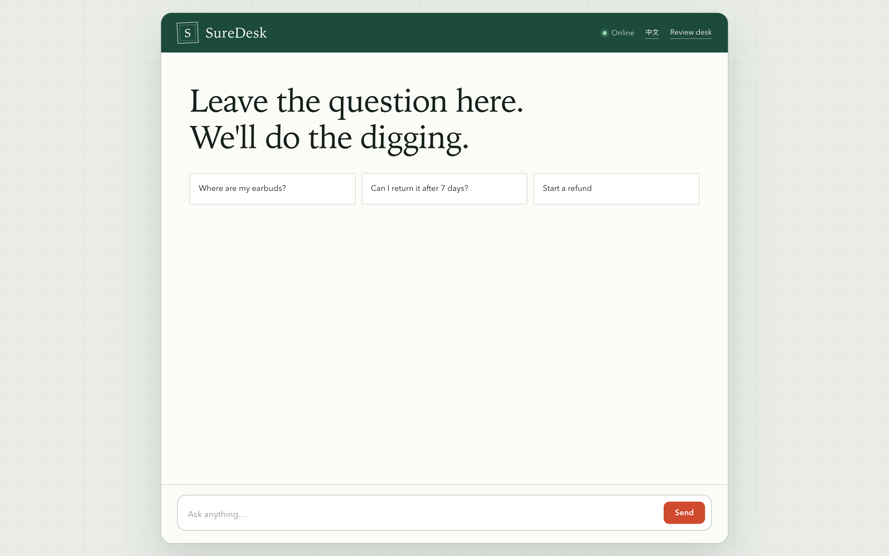
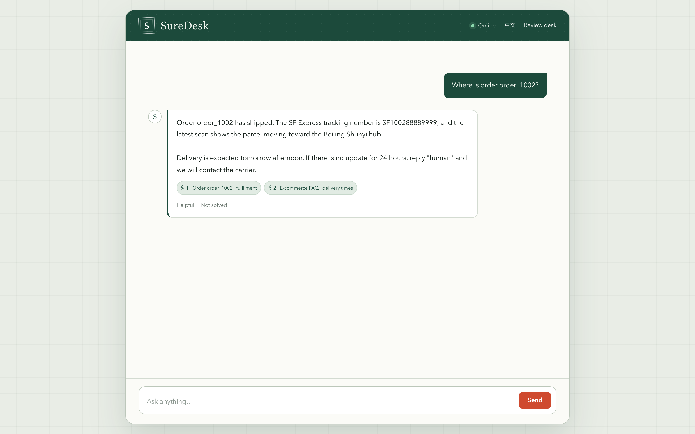
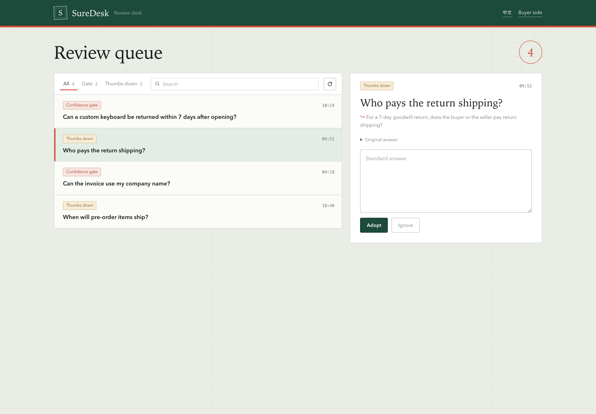
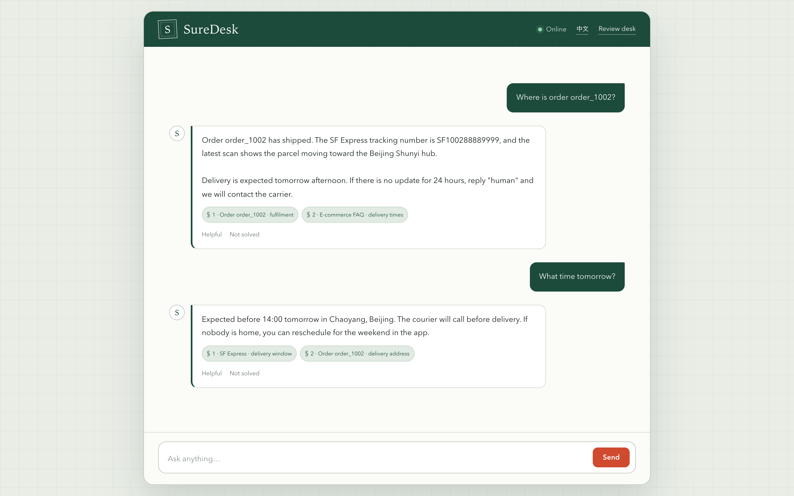
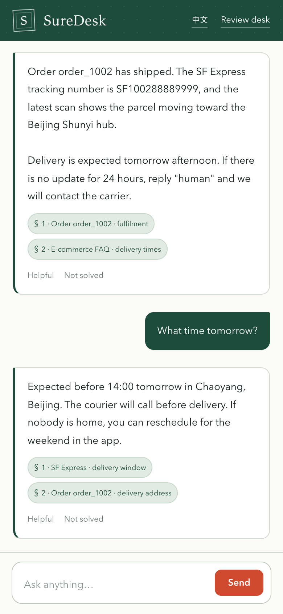

English · <a href="README.zh-CN.md">简体中文</a>

# SureDesk

**Production-grade e-commerce AI customer service**

Grounded answers. Bounded promises. A data loop that closes.

SureDesk treats a customer service reply as a business commitment. It can look up orders, track parcels and run refunds by rule, and it stops when the evidence is thin—routing the question to an operator instead of inventing a plausible answer.

Customer chat lives at **/chat**, the operator review desk at **/workbench**, and API docs at **/docs**. The interface is English by default, with a Chinese switch in the header.

## Interface

The design borrows from a parcel dispatch counter: a deep pine counter, postal-red actions, paper-slip messages, and tabular order details. The review desk uses the same language as an audit ledger—queue on the left, review sheet on the right—so an answer can be completed and sent back to the knowledge base.

<table>
<tr>
<td width="64%"></td>
<td width="36%"></td>
</tr>
<tr>
<td>Streamed answers carry their evidence; a negative vote enters the problem pool.</td>
<td>Filter by source, search, write a standard answer and adopt it.</td>
</tr>
</table>

<table>
<tr>
<td width="62%"></td>
<td width="24%"></td>
</tr>
<tr>
<td>Pronoun resolution keeps the order context from the previous turn.</td>
<td>Mobile keeps the conversation, citations and feedback.</td>
</tr>
</table>

## How it works

~~~mermaid
flowchart LR
    U[Customer question] --> A[Signed identity]
    A --> M[Dual-layer memory rewrite + slot filling]
    M --> R{Nine intents}
    R -->|Chit-chat / unsafe| D[Direct fallback]
    R -->|Complaint| H[Human handoff]
    R -->|Missing details| C[Clarify]
    R -->|Refund| F[Deterministic refund state machine]
    R -->|Policy / order| K[Hybrid retrieval + tools]
    K --> G{Confidence gate}
    G -->|Pass| S[Streamed answer + citations]
    G -->|Low| P[Problem pool]
    S --> T[Trace / audit]
    P --> W[Operator review]
    W -->|Write standard answer| KB[(Knowledge base)]
    KB --> K
~~~

The point is not that a model is connected. The point is where uncertainty gets stopped:

- **Answers pass an evidence gate.** Dense and BM25 retrieval, RRF fusion, then relevance reranking. If the score is too low, the system refuses to make a commitment.
- **Refunds run as code.** The seven-day rule, order ownership and idempotency live in a deterministic state machine. The model only routes the request to the right entry point.
- **Unanswered questions do not disappear.** Low confidence, failed self-evaluation and negative votes converge in the problem pool. An operator answer is vectorized back into the index.

## Architecture and implementation

SureDesk is a single FastAPI service with clear seams, rather than a distributed system. One process serves the SSE chat endpoint, the operator APIs and the two static pages; SQLite keeps the demo self-contained. Business branches stay deterministic. When `ENABLE_LLM_ANSWERS` is on and an API key is configured (the default), chat and grounded policy answers are synthesized by the LLM from the retrieved evidence; the extractive answer remains the fallback.

The implementation is organized around replaceable boundaries:

| Boundary | Location | Responsibility |
|---|---|---|
| API | `newcode/api/` | Signed identity, SSE chat, feedback, workbench routes |
| Orchestration | `newcode/workflow/`, `newcode/services/` | Memory, query rewrite, intent routing, suspend/resume |
| Retrieval | `newcode/rag/` | Chunking, dense hashed vectors, BM25, RRF, reranking |
| Guard | `newcode/guard/` | Pre-generation confidence decision |
| Tools | `newcode/tools/` | Schema validation, timeouts, audit, MCP adapter |
| Data | `newcode/models/`, `newcode/services/problem_pool.py` | Users, orders, logistics, problem pool, audit, knowledge sync |

~~~mermaid
flowchart TB
    subgraph Browser["Browser"]
        Chat["Chat UI /chat"]
        Desk["Review desk /workbench"]
    end

    subgraph API["FastAPI application"]
        Auth["Signed identity role guard"]
        Stream["/api/chat/stream SSE"]
        Review["/api/workbench/*"]
    end

    subgraph Workflow["Workflow and services"]
        Graph["CustomerServiceWorkflow"]
        Memory["Dual-layer memory"]
        Router["Rewrite + 9-intent router"]
        Refund["Deterministic refund workflow"]
        Agent["Agent / RAG node"]
    end

    subgraph Retrieval["Retrieval and guard"]
        Split["Hierarchical chunker"]
        Dense["Hashed dense vectors"]
        BM25["BM25"]
        RRF["RRF fusion"]
        Rerank["Relevance reranker"]
        Gate["Confidence gate"]
    end

    subgraph Business["Business tools"]
        Registry["Tool registry schema + timeout + audit"]
        Orders["Order tools"]
        Logistics["Logistics tools"]
        MCP["MCP adapter"]
    end

    subgraph Storage["Persistence and telemetry"]
        DB[("SQLite SQLAlchemy async")]
        Pool[("Problem pool")]
        Audit[("Audit + trace")]
        KB[("Knowledge base")]
    end

    LLM["LLM provider optional"]
    Answer["Grounded answer + citation"]

    Chat --> Stream
    Desk --> Review
    Stream --> Auth
    Review --> Auth
    Auth --> Graph
    Graph --> Memory
    Memory --> Router
    Router --> Refund
    Router --> Agent
    Agent --> Split
    Split --> Dense
    Split --> BM25
    Dense --> RRF
    BM25 --> RRF
    RRF --> Rerank
    Rerank --> Gate
    Gate -->|pass| Answer
    Gate -->|low confidence| Pool
    Agent --> Registry
    Registry --> Orders
    Registry --> Logistics
    Registry --> MCP
    LLM -.->|optional synthesis| Answer
    Answer --> Stream
    Stream --> Audit
    Pool --> Review
    Review --> KB
    KB --> Split
    Graph --> DB
~~~

### Tech stack

| Area | Stack | Role |
|---|---|---|
| Runtime and API | Python 3.11+, FastAPI, Uvicorn, Pydantic v2 | Typed HTTP boundaries and SSE streaming |
| Persistence | SQLAlchemy 2 async, aiosqlite, SQLite | Async sessions, orders, problem pool, audit logs |
| LLM client | OpenAI-compatible async client | Provider-agnostic synthesis, structured output and streaming, enabled by `ENABLE_LLM_ANSWERS` |
| Retrieval | NumPy, rank-bm25 | Deterministic hashed n-gram vectors, BM25, RRF |
| Reranking | Local relevance scorer behind a replaceable interface | Lexical coverage, Jaccard overlap and title bonus |
| Security | Signed bearer tokens, role checks, SecurityContext | Authentication, authorization and row-level IDOR defense |
| Observability | Request tracer and audit log | Trace IDs, stage latency, token usage, evidence snapshots |
| Frontend | Vanilla HTML/CSS/JavaScript | SSE via ReadableStream, responsive chat and review desk |
| Testing | pytest, pytest-asyncio, Playwright | Unit, integration, acceptance, browser and screenshot checks |
| Offline experiment | NumPy logistic regression | Hashed character/bi-gram features, training and evaluation |

### Request lifecycle

~~~mermaid
stateDiagram-v2
    [*] --> LoadContext: User Message
    LoadContext --> IntentRewrite: Dual-Layer Memory & Context Resolution
    IntentRewrite --> Clarify: Missing Essential Slots
    Clarify --> [*]: Request Clarification from User
    IntentRewrite --> Route: Resolved Query & 9-Intent Classifier

    state Route {
        [*] --> BranchDecision
        BranchDecision --> FallbackDirect: Chitchat / Safety Violation
        BranchDecision --> TransferHuman: Complaint / Human Escalation
        BranchDecision --> RefundWorkflow: Deterministic Refund Workflow
        BranchDecision --> RAGKnowledge: Policy & Knowledge Q&A
        BranchDecision --> ToolAgent: Order & Logistics Queries
    }

    RefundWorkflow --> CheckOrder: Check Order Ownership & 7-Day Window
    CheckOrder --> OrderIneligible: Expired / Ineligible (Strict Rejection)
    CheckOrder --> OrderEligible: Compliant (Issue RFV Voucher)

    RAGKnowledge --> DenseAndBM25: Dual-Path Retrieval
    DenseAndBM25 --> RRFFusion: Reciprocal Rank Fusion (RRF)
    RRFFusion --> CrossEncoderRerank: Relevance Reranking
    CrossEncoderRerank --> ConfidenceGate: Score & Evidence Threshold Check

    ConfidenceGate --> LowConfidencePool: Score < Threshold (Reject & Log to Problem Pool)
    ConfidenceGate --> MainAgent: Evidence Grounded (Pass to Generator)
    ToolAgent --> MainAgent: Tool Execution Results

    MainAgent --> SafetyCheck: Answer Synthesis & Citation
    SafetyCheck --> StreamResponse: SSE Streaming Output
    StreamResponse --> AuditTrace: Request-Level Tracing & Audit Log

    LowConfidencePool --> ReviewWorkbench: Operator Review & Standard Answer Ingestion
    ReviewWorkbench --> SyncKnowledge: Auto Vectorize & Sync Back to Knowledge Base
    SyncKnowledge --> [*]
    AuditTrace --> [*]
~~~

The diagram shows the full flow. The router is rule-based; when the LLM is enabled, the generation node answers from the supplied evidence and appends a citation. If the LLM is disabled, unavailable or times out, the node falls back to the best evidence chunk plus citation.

### Implementation notes

- **Deterministic first.** The router narrows every message to five routes, and refunds are executed by a state machine with suspend/resume. The LLM never owns order state or refund eligibility.
- **Evidence before answer.** The confidence gate rejects empty or below-threshold evidence before the answer is assembled, so a refusal is cheaper and safer than a post-hoc filter.
- **The extractive path is the fallback.** The router is rule-based. With `ENABLE_LLM_ANSWERS` and a key, the RAG node asks the model to answer only from the supplied evidence; on timeout, error or an empty response it returns the highest-ranked chunk with a citation, so the demo still runs without an API key.
- **Zero trust at the tool boundary.** Tools receive a `SecurityContext`, re-check row ownership in SQL, and append an audit record when a cross-user probe is blocked.
- **Local retrieval by default.** The dense retriever uses deterministic token-hash vectors and the reranker uses lexical overlap plus a title bonus, so retrieval works without an embedding service. Both sit behind interfaces that can accept a neural encoder or cross-encoder.
- **Memory is a budget.** The near window keeps four turns (eight messages); older turns are compressed into a summary while order IDs and product entities are extracted and retained.
- **The flywheel is a real write path.** Confidence-gate rejections, self-evaluation failures and negative votes enter the problem pool; `adopt_and_sync` writes the standard answer back into the chunk index, and the next identical question retrieves it.
- **Observability is request-level.** `RequestTracer` records stage latency, token accounting and retrieved evidence per request; blocked IDOR probes and tool failures are persisted in `AuditLog`.
- **The UI is deliberately small.** The frontend is dependency-free HTML/CSS/JavaScript: it consumes SSE with `ReadableStream`, renders answers and citations, and persists only the access token and language choice.

## Core capabilities

| Layer | What it does | Key pieces |
|---|---|---|
| Identity and access | Every order or logistics lookup is bound to the authenticated user; cross-user probing is blocked and audited | SecurityContext, row-level ownership checks, AuditLog |
| Question understanding | Pronoun resolution, short-query completion, nine intents mapped onto five convergence routes | DualLayerMemory, QueryRewriter, IntentRouter |
| Knowledge QA | Heading-aware chunking, dense + BM25 retrieval, RRF fusion, relevance reranking | chunking, dense, bm25, fusion, reranker |
| Generation boundary | Rerank score and evidence coverage checked before generation; low confidence is refused and logged | ConfidenceGate, ProblemPool |
| Business execution | Refund suspend/resume, seven-day rule, idempotent vouchers, order and logistics tools | refund_workflow, ToolRegistry, MCP adapter |
| Operations loop | Review queue, standard-answer authoring, knowledge sync, hit verification | Workbench, adopt_and_sync |
| Observability | Trace ID, stage latency, token usage, evidence snapshots | RequestTracer, stage metrics |
| Offline experiments | Intent dataset, feature extraction, training and confusion-matrix evaluation | offline/train.py, offline/evaluate.py |

## Project layout

~~~text
newcode/
├── api/          # auth, SSE chat, feedback, workbench endpoints
├── core/         # settings, database, LLM wrapper, tracing
├── guard/        # pre-generation confidence gate
├── models/       # User / Order / Logistics / ProblemPool / AuditLog
├── offline/      # intent classifier training and evaluation
├── rag/          # chunking, dense, BM25, RRF, reranking, evaluation
├── services/     # memory, router, problem pool, runtime assembly
├── tools/        # order and logistics tools, registry, MCP adapter
├── workflow/     # orchestration and deterministic refund workflow
└── ui/static/    # chat.html / workbench.html

docs/
├── SPEC.md                  # requirements
├── PLAN.md                  # implementation plan
├── ACCEPTANCE_REPORT.md     # acceptance evidence
├── RAG_EVALUATION.md        # retrieval benchmarks
├── learning-agent/          # eight-part code walkthrough
├── tutorial/                # product demo video
└── screenshots/             # README screenshots (en / zh)

scripts/
├── seed_data.py             # seed data
├── create_access_token.py   # local signed token
├── evaluate_rag.py          # RAG benchmark
└── capture_ui.py            # browser screenshots and visual checks
~~~

## Quick start

Requires Python 3.11+ and [uv](https://github.com/astral-sh/uv).

~~~bash
git clone git@github.com:ZhenweiTang0908/SureDesk.git
cd SureDesk
uv venv .venv
source .venv/bin/activate
uv pip install -e ".[dev]"
~~~

Create .env in the project root:

~~~env
OPENAI_API_BASE=https://1yuanapi.com/v1
OPENAI_API_KEY=your_api_key_here
OPENAI_MODEL=gpt-5.6-terra
ENABLE_LLM_ANSWERS=True
DATABASE_URL=sqlite+aiosqlite:///suredesk.db
AUTH_SECRET=replace-with-a-long-random-secret
CORS_ALLOWED_ORIGINS=http://localhost:8000
DEBUG=False
~~~

With `ENABLE_LLM_ANSWERS=True` and a valid key, chat and policy answers are generated by the model from retrieved evidence. Set it to `False` for a fully offline deterministic demo; the extractive path still works.

Seed the database, create tokens, and start the server:

~~~bash
.venv/bin/python scripts/seed_data.py

.venv/bin/python scripts/create_access_token.py user_buyer_1 --role BUYER
.venv/bin/python scripts/create_access_token.py user_operator_1 --role OPERATOR

.venv/bin/uvicorn newcode.main:app --host 127.0.0.1 --port 8000
~~~

Store the matching token in the browser console and reload:

~~~javascript
localStorage.setItem("suredesk_access_token", "paste-your-token");
location.reload();
~~~

- Customer chat: [http://127.0.0.1:8000/chat](http://127.0.0.1:8000/chat)
- Operator review desk: [http://127.0.0.1:8000/workbench](http://127.0.0.1:8000/workbench)
- API docs: [http://127.0.0.1:8000/docs](http://127.0.0.1:8000/docs)

Use the **中文 / EN** control in the header to switch the interface language; the choice is stored in localStorage.

## Tests and evaluation

~~~bash
# unit, integration, frontend security and acceptance tests
.venv/bin/python -m pytest -q

# six acceptance criteria
.venv/bin/python -m pytest tests/test_full_acceptance.py -v

# retrieval benchmark
.venv/bin/python scripts/evaluate_rag.py
~~~

| Criterion | Metric | Result |
|---|---|---|
| AC1 intent and pronoun resolution | 20 multi-turn cases | 100% (20/20) |
| AC2 IDOR defense | cross-user order probing | 100% blocked and audited |
| AC3 hybrid retrieval | Recall@5 / MRR | 100% / 0.9500 |
| AC4 confidence gate | unsupported questions | 100% refused, 0 hallucinated commitments |
| AC5 refund rules | orders older than 7 days | 100% hard rejection |
| AC6 data flywheel | reject → review → ingest → hit | closed-loop verified |

## Interface design and screenshots

The UI was designed and verified with Anthropic's public [frontend-design](https://github.com/anthropics/skills/tree/main/skills/frontend-design) and [webapp-testing](https://github.com/anthropics/skills/tree/main/skills/webapp-testing) skills. Both are vendored under .claude/skills/ with their Apache 2.0 licenses.

Regenerate the README screenshots:

~~~bash
uv pip install -e ".[screenshots]"
.venv/bin/playwright install chromium

# start the server in another terminal, then:
AUTH_SECRET=replace-with-the-same-secret .venv/bin/python scripts/capture_ui.py
~~~

The capture script checks desktop, mobile and review-desk layouts in Chromium and writes English and Chinese sets to docs/screenshots/en/ and docs/screenshots/zh/.

## Docs

- [Requirements](docs/SPEC.md) · [Plan](docs/PLAN.md) · [Acceptance report](docs/ACCEPTANCE_REPORT.md)
- [RAG evaluation](docs/RAG_EVALUATION.md)
- [Code walkthrough](docs/learning-agent/README.md)
- [Product demo](docs/tutorial/README.md)

## License

MIT

