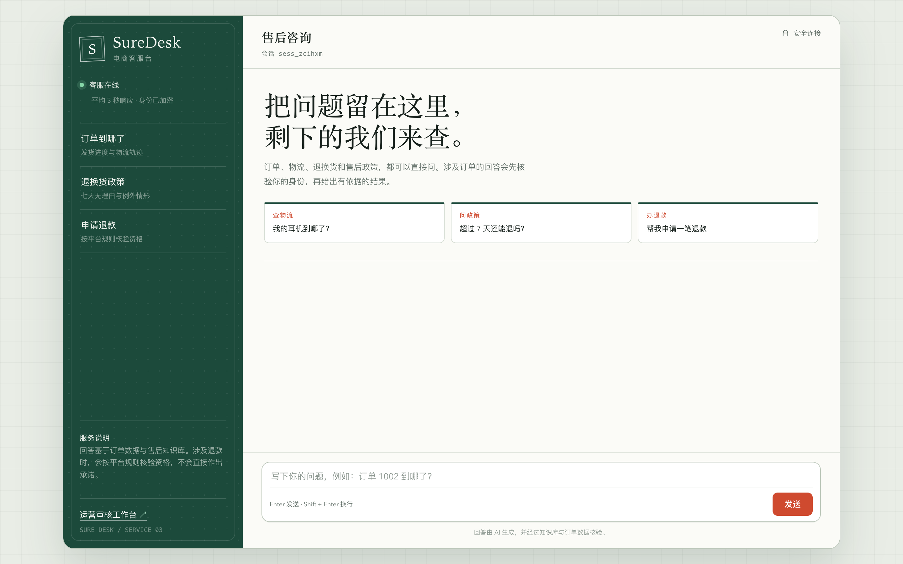
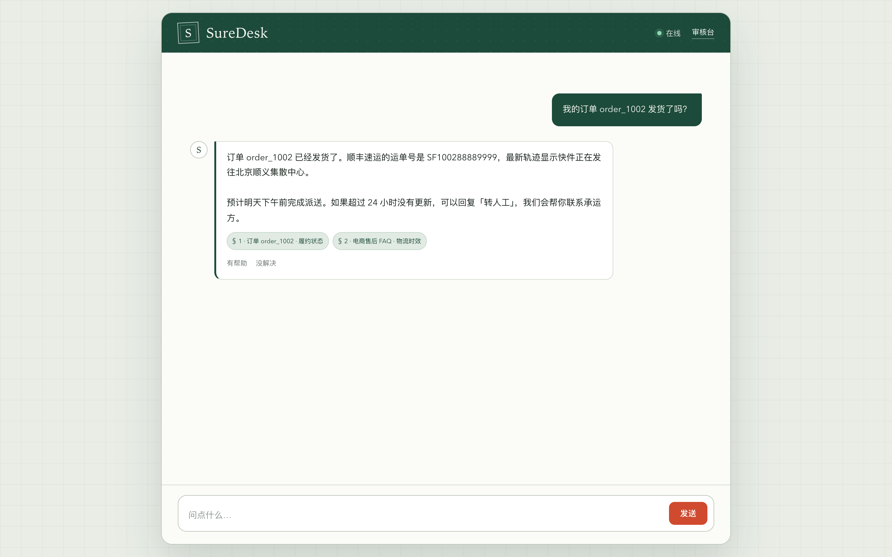
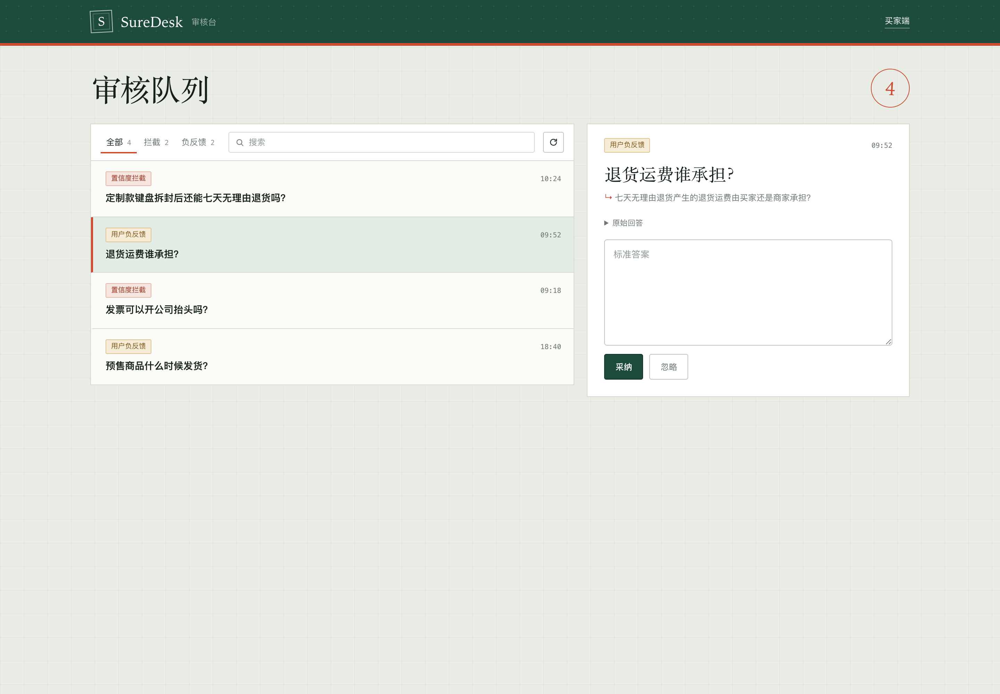
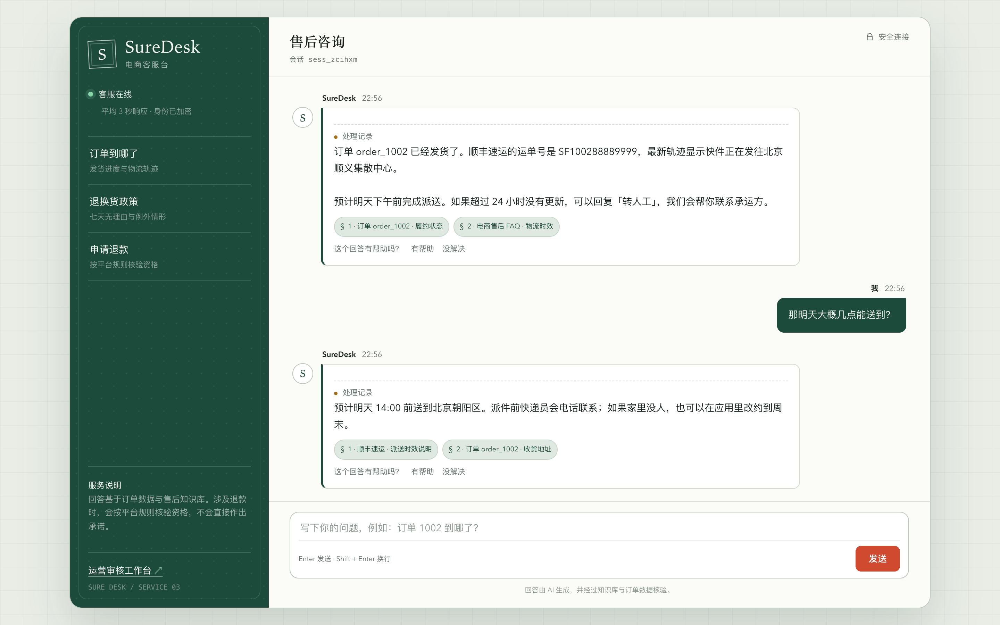
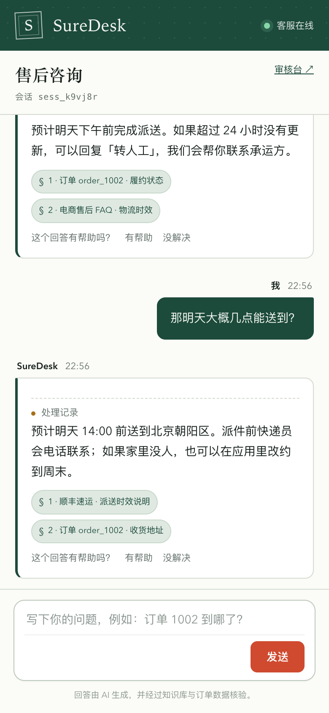

# SureDesk · 定策

**生产级电商 AI 智能客服**

有依据的回答，有边界的承诺，能回流的数据。

SureDesk 把「客服回答」当作一项业务承诺来处理：它能查订单、追物流、按规则处理退款，也会在证据不足时停下来，把问题交给运营，而不是编一个听起来合理的答案。

买家端在 **/chat**，运营审核台在 **/workbench**，接口文档在 **/docs**。

## 界面

对话页采用「包裹分拣台」的视觉语言：深松绿的柜台、邮戳红的操作色、纸条式的消息卡片和等宽字体的订单信息。工作台则是同一套语言下的审核台账，左侧队列、右侧审核单，补全答案后直接写入知识库。

<table>
<tr>
<td width="64%"></td>
<td width="36%"></td>
</tr>
<tr>
<td>流式回答附带检索依据；点踩会进入问题池。</td>
<td>按来源筛选、搜索、补全标准答案并一键入库。</td>
</tr>
</table>

<table>
<tr>
<td width="62%"></td>
<td width="24%"></td>
</tr>
<tr>
<td>指代消解后继续沿用上一轮的订单上下文。</td>
<td>移动端保留完整对话、引用与反馈入口。</td>
</tr>
</table>

## 它怎么工作

~~~mermaid
flowchart LR
    U[买家提问] --> A[签名鉴权]
    A --> M[双层记忆 改写与补槽]
    M --> R{九类意图}
    R -->|闲聊 / 违规| D[直接兜底]
    R -->|投诉| H[转人工]
    R -->|信息不足| C[追问]
    R -->|退款| F[确定性退款状态机]
    R -->|政策 / 订单| K[混合检索 + 工具调用]
    K --> G{置信度闸门}
    G -->|通过| S[流式回答 + 引用]
    G -->|不足| P[问题池]
    S --> T[Trace / 审计]
    P --> W[运营审核台]
    W -->|补全标准答案| KB[(知识库)]
    KB --> K
~~~

关键不是「接了大模型」，而是把不确定的地方收住：

- **答案先过证据关。** Dense + BM25 双路召回，RRF 融合，Cross-Encoder 重排；分数不够就不让模型生成承诺。
- **退款交给代码。** 七天规则、订单归属和幂等由确定性状态机执行，模型只负责把请求送到正确入口。
- **没答上的问题不会消失。** 低置信度、自评失败和用户点踩统一进入问题池，运营补全后立即向量化回流。

## 核心能力

| 层面 | 做了什么 | 关键实现 |
|---|---|---|
| 身份与权限 | 每次订单/物流查询都绑定认证身份，跨用户探测直接拦截并审计 | SecurityContext、行级归属校验、AuditLog |
| 问题理解 | 多轮指代消解、短句补全、九类意图映射到五条收敛路由 | DualLayerMemory、QueryRewriter、IntentRouter |
| 知识问答 | 标题层级感知切分，Dense 与 BM25 双路召回，RRF 融合后重排 | chunking、dense、bm25、fusion、reranker |
| 生成边界 | 生成前检查重排分数与证据覆盖，不足则礼貌拒答并入库 | ConfidenceGate、ProblemPool |
| 业务执行 | 退款挂起/恢复、七天硬规则、幂等凭证、订单与物流工具 | refund_workflow、ToolRegistry、MCP adapter |
| 运营闭环 | 审核队列、标准答案补全、知识库同步、命中验证 | Workbench、adopt_and_sync |
| 可观测性 | Trace ID、阶段耗时、Token 消耗、证据快照 | RequestTracer、stage metrics |
| 离线实验 | 意图分类数据集、特征提取、训练与混淆矩阵评估 | offline/train.py、offline/evaluate.py |

## 项目结构

~~~text
newcode/
├── api/          # 鉴权、SSE 对话、反馈、审核台接口
├── core/         # 配置、数据库、LLM 封装、Tracing
├── guard/        # 生成前置信度闸门
├── models/       # User / Order / Logistics / ProblemPool / AuditLog
├── offline/      # 意图分类训练与评估
├── rag/          # 切分、Dense、BM25、RRF、重排、评测
├── services/     # 记忆、路由、问题池、运行时组装
├── tools/        # 订单与物流工具、工具注册表、MCP 适配
├── workflow/     # 总编排与确定性退款状态机
└── ui/static/    # chat.html / workbench.html

docs/
├── SPEC.md                  # 需求规格
├── PLAN.md                  # 实施计划
├── ACCEPTANCE_REPORT.md     # 验收报告
├── RAG_EVALUATION.md        # 检索评测
├── learning-agent/          # 八篇源码导读
├── tutorial/                # 产品演示视频
└── screenshots/             # README 界面截图

scripts/
├── seed_data.py             # 种子数据
├── create_access_token.py   # 本地签名令牌
├── evaluate_rag.py          # RAG 基准评测
└── capture_ui.py            # 浏览器截图与视觉检查
~~~

## 快速开始

需要 Python 3.11+ 和 [uv](https://github.com/astral-sh/uv)。

~~~bash
git clone git@github.com:ZhenweiTang0908/SureDesk.git
cd SureDesk
uv venv .venv
source .venv/bin/activate
uv pip install -e ".[dev]"
~~~

在根目录创建 .env：

~~~env
OPENAI_API_BASE=https://1yuanapi.com/v1
OPENAI_API_KEY=your_api_key_here
OPENAI_MODEL=gpt-5.6-terra
DATABASE_URL=sqlite+aiosqlite:///suredesk.db
AUTH_SECRET=replace-with-a-long-random-secret
CORS_ALLOWED_ORIGINS=http://localhost:8000
DEBUG=False
~~~

初始化数据、创建令牌并启动：

~~~bash
.venv/bin/python scripts/seed_data.py

.venv/bin/python scripts/create_access_token.py user_buyer_1 --role BUYER
.venv/bin/python scripts/create_access_token.py user_operator_1 --role OPERATOR

.venv/bin/uvicorn newcode.main:app --host 127.0.0.1 --port 8000
~~~

打开页面后，在浏览器控制台写入对应令牌并刷新：

~~~javascript
localStorage.setItem("suredesk_access_token", "粘贴对应令牌");
location.reload();
~~~

- 买家对话：[http://127.0.0.1:8000/chat](http://127.0.0.1:8000/chat)
- 运营审核台：[http://127.0.0.1:8000/workbench](http://127.0.0.1:8000/workbench)
- 接口文档：[http://127.0.0.1:8000/docs](http://127.0.0.1:8000/docs)

## 测试与评测

~~~bash
# 单元、集成、前端安全与验收测试
.venv/bin/python -m pytest -q

# 六项验收标准
.venv/bin/python -m pytest tests/test_full_acceptance.py -v

# RAG 检索基准
.venv/bin/python scripts/evaluate_rag.py
~~~

| 验收项 | 指标 | 结果 |
|---|---|---|
| AC1 意图与指代消解 | 20 组多轮样例 | 100%（20/20） |
| AC2 IDOR 越权防御 | 跨用户订单探测 | 100% 拦截并审计 |
| AC3 混合检索 | Recall@5 / MRR | 100% / 0.9500 |
| AC4 置信度闸门 | 无依据问题拒答 | 100%，0 幻觉承诺 |
| AC5 退款规则 | 超过 7 天硬拦截 | 100% 严格执行 |
| AC6 数据飞轮 | 拒答 → 审核 → 入库 → 命中 | 闭环验证通过 |

## 界面设计与截图

界面使用 Anthropic 公开的 [frontend-design](https://github.com/anthropics/skills/tree/main/skills/frontend-design) 与 [webapp-testing](https://github.com/anthropics/skills/tree/main/skills/webapp-testing) 两个 skill 完成设计和浏览器验收。相关 skill 已收录在 .claude/skills/，并保留 Apache 2.0 许可证。

重新生成 README 截图：

~~~bash
uv pip install -e ".[screenshots]"
.venv/bin/playwright install chromium

# 另开一个终端启动服务后执行
AUTH_SECRET=replace-with-the-same-secret .venv/bin/python scripts/capture_ui.py
~~~

截图脚本会在真实 Chromium 中检查桌面、移动端和工作台布局，并把结果写入 docs/screenshots/。

## 文档

- [需求规格](docs/SPEC.md) · [实施计划](docs/PLAN.md) · [验收报告](docs/ACCEPTANCE_REPORT.md)
- [RAG 评测](docs/RAG_EVALUATION.md)
- [源码导读](docs/learning-agent/README.md)
- [产品演示视频](docs/tutorial/README.md)

## English overview

SureDesk is a production-grade e-commerce AI customer service system. It combines signed identity and row-level order ownership checks, dual-layer conversation memory, nine intents mapped onto five routing channels, hybrid dense + BM25 retrieval with RRF and cross-encoder reranking, a pre-generation confidence gate, deterministic refund rules, and an operator workbench that turns unanswered questions into reviewed knowledge.

The buyer interface streams cited answers over SSE; the workbench lets operators triage low-confidence and negative-feedback questions, write standard answers, and sync them back into the retrieval index. The full test suite covers authentication, IDOR defense, routing, retrieval, refund state transitions, frontend security, and the data flywheel.

See [Quick Start](#快速开始) for local setup and [docs/learning-agent](docs/learning-agent/README.md) for a guided code walkthrough.

## License

MIT

