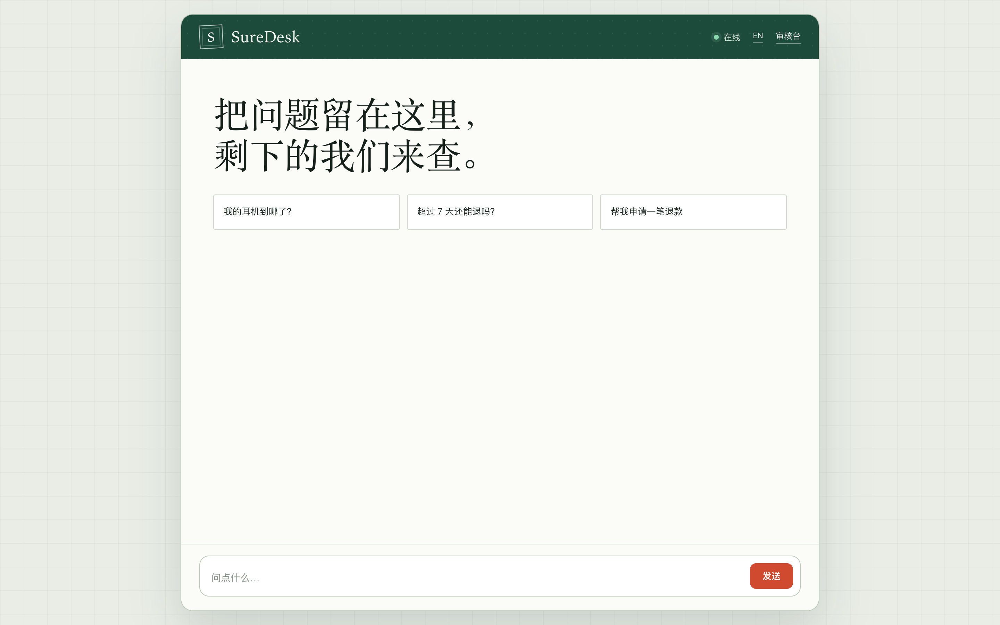
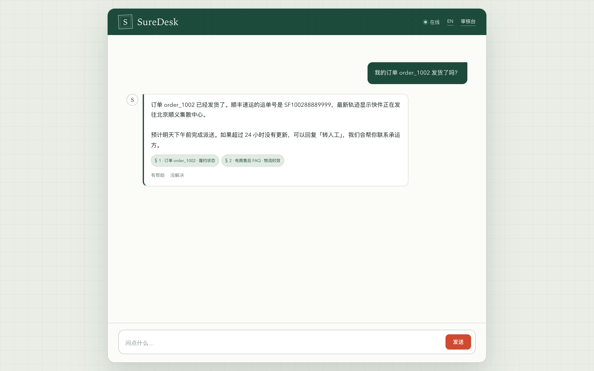
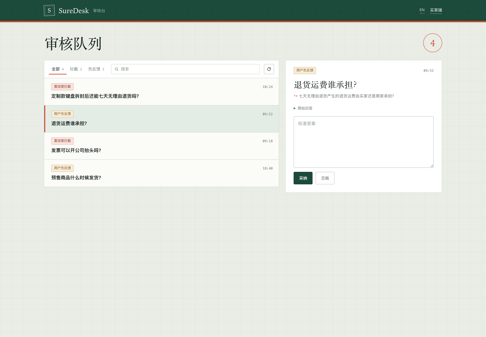
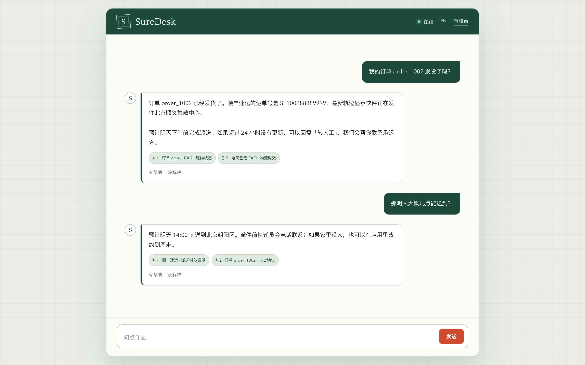
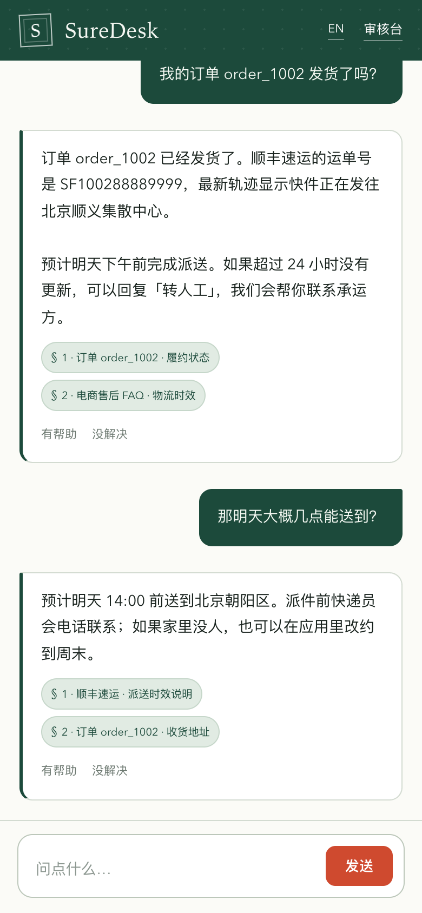

<a href="README.md">English</a> · 简体中文

# SureDesk · 定策

**生产级电商 AI 智能客服**

有依据的回答，有边界的承诺，能回流的数据。

SureDesk 把「客服回答」当作一项业务承诺来处理：它能查订单、追物流、按规则处理退款，也会在证据不足时停下来，把问题交给运营，而不是编一个听起来合理的答案。

买家端在 **/chat**，运营审核台在 **/workbench**，接口文档在 **/docs**。

## 界面

对话页采用「包裹分拣台」的视觉语言：深松绿的柜台、邮戳红的操作色、纸条式的消息卡片和等宽字体的订单信息。工作台则是同一套语言下的审核台账，左侧队列、右侧审核单，补全答案后直接写入知识库。

界面默认英文，右上角可切换中文。

<table>
<tr>
<td width="64%"></td>
<td width="36%"></td>
</tr>
<tr>
<td>流式回答附带检索依据；点踩会进入问题池。</td>
<td>按来源筛选、搜索、补全标准答案并一键入库。</td>
</tr>
</table>

<table>
<tr>
<td width="62%"></td>
<td width="24%"></td>
</tr>
<tr>
<td>指代消解后继续沿用上一轮的订单上下文。</td>
<td>移动端保留完整对话、引用与反馈入口。</td>
</tr>
</table>

## 它怎么工作

~~~mermaid
flowchart LR
    U[买家提问] --> A[签名鉴权]
    A --> M[双层记忆 改写与补槽]
    M --> R{九类意图}
    R -->|闲聊 / 违规| D[直接兜底]
    R -->|投诉| H[转人工]
    R -->|信息不足| C[追问]
    R -->|退款| F[确定性退款状态机]
    R -->|政策 / 订单| K[混合检索 + 工具调用]
    K --> G{置信度闸门}
    G -->|通过| S[流式回答 + 引用]
    G -->|不足| P[问题池]
    S --> T[Trace / 审计]
    P --> W[运营审核台]
    W -->|补全标准答案| KB[(知识库)]
    KB --> K
~~~

关键不是「接了大模型」，而是把不确定的地方收住：

- **答案先过证据关。** Dense + BM25 双路召回，RRF 融合，相关性重排；分数不够系统就拒绝作出承诺。
- **退款交给代码。** 七天规则、订单归属和幂等由确定性状态机执行，模型只负责把请求送到正确入口。
- **没答上的问题不会消失。** 低置信度、自评失败和用户点踩统一进入问题池，运营补全后立即向量化回流。

## 架构与实现

SureDesk 是一个带有清晰边界的单体 FastAPI 服务，而不是分布式系统。一个进程同时提供 SSE 对话接口、运营接口和两个静态页面；SQLite 让本地演示可以单机运行。业务分支保持确定性；当 `ENABLE_LLM_ANSWERS` 开启且配置了 API Key（默认如此）时，闲聊和有证据支撑的政策回答由 LLM 基于检索证据生成，抽取式回答作为回退。

代码按可替换的边界拆分：

| 边界 | 位置 | 职责 |
|---|---|---|
| API | `newcode/api/` | 签名身份、SSE 对话、反馈、审核台路由 |
| 编排 | `newcode/workflow/`、`newcode/services/` | 记忆、问题改写、意图路由、挂起与恢复 |
| 检索 | `newcode/rag/` | 切分、哈希稠密向量、BM25、RRF、重排 |
| 闸门 | `newcode/guard/` | 生成前的置信度决策 |
| 工具 | `newcode/tools/` | 参数校验、超时、审计、MCP 适配 |
| 数据 | `newcode/models/`、`newcode/services/problem_pool.py` | 用户、订单、物流、问题池、审计、知识同步 |

~~~mermaid
flowchart TB
    subgraph Browser["浏览器"]
        Chat["对话界面 /chat"]
        Desk["审核台 /workbench"]
    end

    subgraph API["FastAPI 应用"]
        Auth["签名身份 角色校验"]
        Stream["/api/chat/stream SSE"]
        Review["/api/workbench/*"]
    end

    subgraph Workflow["工作流与服务"]
        Graph["CustomerServiceWorkflow"]
        Memory["双层记忆"]
        Router["改写 + 九类意图路由"]
        Refund["确定性退款流程"]
        Agent["Agent / RAG 节点"]
    end

    subgraph Retrieval["检索与闸门"]
        Split["层级切分器"]
        Dense["哈希稠密向量"]
        BM25["BM25"]
        RRF["RRF 融合"]
        Rerank["相关性重排"]
        Gate["置信度闸门"]
    end

    subgraph Business["业务工具"]
        Registry["工具注册表 参数 + 超时 + 审计"]
        Orders["订单工具"]
        Logistics["物流工具"]
        MCP["MCP 适配"]
    end

    subgraph Storage["持久化与遥测"]
        DB[("SQLite SQLAlchemy async")]
        Pool[("问题池")]
        Audit[("审计 + Trace")]
        KB[("知识库")]
    end

    LLM["LLM 提供方 可选"]
    Answer["有依据的回答 + 引用"]

    Chat --> Stream
    Desk --> Review
    Stream --> Auth
    Review --> Auth
    Auth --> Graph
    Graph --> Memory
    Memory --> Router
    Router --> Refund
    Router --> Agent
    Agent --> Split
    Split --> Dense
    Split --> BM25
    Dense --> RRF
    BM25 --> RRF
    RRF --> Rerank
    Rerank --> Gate
    Gate -->|通过| Answer
    Gate -->|低置信度| Pool
    Agent --> Registry
    Registry --> Orders
    Registry --> Logistics
    Registry --> MCP
    LLM -.->|可选生成| Answer
    Answer --> Stream
    Stream --> Audit
    Pool --> Review
    Review --> KB
    KB --> Split
    Graph --> DB
~~~

### 技术栈

| 层面 | 技术 | 作用 |
|---|---|---|
| 运行时与 API | Python 3.11+、FastAPI、Uvicorn、Pydantic v2 | 类型化 HTTP 边界与 SSE 流式输出 |
| 持久化 | SQLAlchemy 2 async、aiosqlite、SQLite | 异步会话、订单、问题池、审计日志 |
| LLM 客户端 | OpenAI 兼容异步客户端 | 可切换提供方的对话、结构化输出与流式生成，由 `ENABLE_LLM_ANSWERS` 控制 |
| 检索 | NumPy、rank-bm25 | 确定性哈希 n-gram 向量、BM25、RRF |
| 重排 | 可替换接口后的本地相关性打分 | 查询覆盖、Jaccard 重叠与标题加权 |
| 安全 | 签名 Bearer Token、角色校验、SecurityContext | 认证、授权与行级 IDOR 防御 |
| 可观测性 | RequestTracer、AuditLog | Trace ID、阶段耗时、Token 消耗、证据快照 |
| 前端 | 原生 HTML/CSS/JavaScript | ReadableStream 解析 SSE、响应式对话与审核台 |
| 测试 | pytest、pytest-asyncio、Playwright | 单元、集成、验收、浏览器与截图检查 |
| 离线实验 | NumPy 逻辑回归 | 字符/双字哈希特征、训练与评估 |

### 请求生命周期

~~~mermaid
stateDiagram-v2
    [*] --> LoadContext: 用户消息
    LoadContext --> IntentRewrite: 双层记忆与上下文消解
    IntentRewrite --> Clarify: 缺少关键槽位
    Clarify --> [*]: 向用户追问
    IntentRewrite --> Route: 改写后 Query 与九类意图

    state Route {
        [*] --> BranchDecision
        BranchDecision --> FallbackDirect: 闲聊 / 违规
        BranchDecision --> TransferHuman: 投诉 / 转人工
        BranchDecision --> RefundWorkflow: 确定性退款流程
        BranchDecision --> RAGKnowledge: 政策与知识问答
        BranchDecision --> ToolAgent: 订单与物流查询
    }

    RefundWorkflow --> CheckOrder: 校验订单归属与七天窗口
    CheckOrder --> OrderIneligible: 超期 / 不符合（严格拒绝）
    CheckOrder --> OrderEligible: 合规（生成 RFV 退款凭证）

    RAGKnowledge --> DenseAndBM25: 双路召回
    DenseAndBM25 --> RRFFusion: RRF 倒数排名融合
    RRFFusion --> CrossEncoderRerank: 相关性重排
    CrossEncoderRerank --> ConfidenceGate: 分数与证据阈值检查

    ConfidenceGate --> LowConfidencePool: 低于阈值（拒答并进入问题池）
    ConfidenceGate --> MainAgent: 证据充分（放行到生成节点）
    ToolAgent --> MainAgent: 工具执行结果

    MainAgent --> SafetyCheck: 答案合成与引用
    SafetyCheck --> StreamResponse: SSE 流式输出
    StreamResponse --> AuditTrace: 请求级 Trace 与审计

    LowConfidencePool --> ReviewWorkbench: 运营审核与标准答案入库
    ReviewWorkbench --> SyncKnowledge: 自动向量化并同步知识库
    SyncKnowledge --> [*]
    AuditTrace --> [*]
~~~

这张图描述的是完整流程。路由器基于规则；LLM 开启时，生成节点会基于传入的证据作答并附加引用。如果 LLM 被关闭、不可用或超时，则回退为「最高分证据片段 + 引用」。

### 实现要点

- **确定性优先。** 路由器把每条消息收敛到五个出口，退款由带挂起/恢复的状态机执行。LLM 不拥有订单状态，也不决定退款资格。
- **证据先于回答。** 置信度闸门在组装回答之前检查证据；没有结果或分数低于阈值时直接拒答，比生成后再过滤更便宜，也更安全。
- **抽取式路径是回退。** 路由器基于规则。开启 `ENABLE_LLM_ANSWERS` 并配置 Key 时，RAG 节点要求模型只依据证据回答；如果超时、报错或返回空内容，就回退到排名最高的证据片段并附上引用，因此不配置 API Key 也能运行。
- **工具边界零信任。** 工具接收 `SecurityContext`，在 SQL 层再次校验行归属；跨用户探测被拦截后会写入审计记录。
- **默认本地检索。** 稠密检索使用确定性的 token 哈希向量，重排使用词面覆盖与标题加权，因此不依赖外部 embedding 服务。两者都藏在接口后面，可以替换成神经编码器或 Cross-Encoder。
- **记忆是一份预算。** 近端窗口保留四轮（八条）消息；更早的轮次压缩为摘要，同时保留订单号和商品实体。
- **飞轮是一条真实写路径。** 置信度拦截、自评失败和用户点踩进入问题池；`adopt_and_sync` 把标准答案写回 chunk 索引，下一次相同问题可以直接命中。
- **可观测性做到请求级。** `RequestTracer` 记录阶段耗时、Token 消耗和命中的证据；被拦截的 IDOR 探测与工具失败写入 `AuditLog`。
- **前端刻意保持轻量。** 前端是零依赖的 HTML/CSS/JavaScript，用 `ReadableStream` 消费 SSE，渲染答案与引用，只持久化访问令牌和语言选择。

## 核心能力

| 层面 | 做了什么 | 关键实现 |
|---|---|---|
| 身份与权限 | 每次订单/物流查询都绑定认证身份，跨用户探测直接拦截并审计 | SecurityContext、行级归属校验、AuditLog |
| 问题理解 | 多轮指代消解、短句补全、九类意图映射到五条收敛路由 | DualLayerMemory、QueryRewriter、IntentRouter |
| 知识问答 | 标题层级感知切分，Dense 与 BM25 双路召回，RRF 融合后重排 | chunking、dense、bm25、fusion、reranker |
| 生成边界 | 生成前检查重排分数与证据覆盖，不足则礼貌拒答并入库 | ConfidenceGate、ProblemPool |
| 业务执行 | 退款挂起/恢复、七天硬规则、幂等凭证、订单与物流工具 | refund_workflow、ToolRegistry、MCP adapter |
| 运营闭环 | 审核队列、标准答案补全、知识库同步、命中验证 | Workbench、adopt_and_sync |
| 可观测性 | Trace ID、阶段耗时、Token 消耗、证据快照 | RequestTracer、stage metrics |
| 离线实验 | 意图分类数据集、特征提取、训练与混淆矩阵评估 | offline/train.py、offline/evaluate.py |

## 项目结构

~~~text
newcode/
├── api/          # 鉴权、SSE 对话、反馈、审核台接口
├── core/         # 配置、数据库、LLM 封装、Tracing
├── guard/        # 生成前置信度闸门
├── models/       # User / Order / Logistics / ProblemPool / AuditLog
├── offline/      # 意图分类训练与评估
├── rag/          # 切分、Dense、BM25、RRF、重排、评测
├── services/     # 记忆、路由、问题池、运行时组装
├── tools/        # 订单与物流工具、工具注册表、MCP 适配
├── workflow/     # 总编排与确定性退款状态机
└── ui/static/    # chat.html / workbench.html

docs/
├── SPEC.md                  # 需求规格
├── PLAN.md                  # 实施计划
├── ACCEPTANCE_REPORT.md     # 验收报告
├── RAG_EVALUATION.md        # 检索评测
├── learning-agent/          # 八篇源码导读
├── tutorial/                # 产品演示视频
└── screenshots/             # README 界面截图

scripts/
├── seed_data.py             # 种子数据
├── create_access_token.py   # 本地签名令牌
├── evaluate_rag.py          # RAG 基准评测
└── capture_ui.py            # 浏览器截图与视觉检查
~~~

## 快速开始

需要 Python 3.11+ 和 [uv](https://github.com/astral-sh/uv)。

~~~bash
git clone git@github.com:ZhenweiTang0908/SureDesk.git
cd SureDesk
uv venv .venv
source .venv/bin/activate
uv pip install -e ".[dev]"
~~~

在根目录创建 .env：

~~~env
OPENAI_API_BASE=https://1yuanapi.com/v1
OPENAI_API_KEY=your_api_key_here
OPENAI_MODEL=gpt-5.6-terra
ENABLE_LLM_ANSWERS=True
DATABASE_URL=sqlite+aiosqlite:///suredesk.db
AUTH_SECRET=replace-with-a-long-random-secret
CORS_ALLOWED_ORIGINS=http://localhost:8000
DEBUG=False
~~~

当 `ENABLE_LLM_ANSWERS=True` 且 Key 有效时，闲聊和政策回答由模型基于检索证据生成；设为 `False` 就回到完全离线的确定性模式，抽取式回答仍然可用。

初始化数据、创建令牌并启动：

~~~bash
.venv/bin/python scripts/seed_data.py

.venv/bin/python scripts/create_access_token.py user_buyer_1 --role BUYER
.venv/bin/python scripts/create_access_token.py user_operator_1 --role OPERATOR

.venv/bin/uvicorn newcode.main:app --host 127.0.0.1 --port 8000
~~~

打开页面后，在浏览器控制台写入对应令牌并刷新：

~~~javascript
localStorage.setItem("suredesk_access_token", "粘贴对应令牌");
location.reload();
~~~

- 买家对话：[http://127.0.0.1:8000/chat](http://127.0.0.1:8000/chat)
- 运营审核台：[http://127.0.0.1:8000/workbench](http://127.0.0.1:8000/workbench)
- 接口文档：[http://127.0.0.1:8000/docs](http://127.0.0.1:8000/docs)

## 测试与评测

~~~bash
# 单元、集成、前端安全与验收测试
.venv/bin/python -m pytest -q

# 六项验收标准
.venv/bin/python -m pytest tests/test_full_acceptance.py -v

# RAG 检索基准
.venv/bin/python scripts/evaluate_rag.py
~~~

| 验收项 | 指标 | 结果 |
|---|---|---|
| AC1 意图与指代消解 | 20 组多轮样例 | 100%（20/20） |
| AC2 IDOR 越权防御 | 跨用户订单探测 | 100% 拦截并审计 |
| AC3 混合检索 | Recall@5 / MRR | 100% / 0.9500 |
| AC4 置信度闸门 | 无依据问题拒答 | 100%，0 幻觉承诺 |
| AC5 退款规则 | 超过 7 天硬拦截 | 100% 严格执行 |
| AC6 数据飞轮 | 拒答 → 审核 → 入库 → 命中 | 闭环验证通过 |

## 界面设计与截图

界面使用 Anthropic 公开的 [frontend-design](https://github.com/anthropics/skills/tree/main/skills/frontend-design) 与 [webapp-testing](https://github.com/anthropics/skills/tree/main/skills/webapp-testing) 两个 skill 完成设计和浏览器验收。相关 skill 已收录在 .claude/skills/，并保留 Apache 2.0 许可证。

重新生成 README 截图：

~~~bash
uv pip install -e ".[screenshots]"
.venv/bin/playwright install chromium

# 另开一个终端启动服务后执行
AUTH_SECRET=replace-with-the-same-secret .venv/bin/python scripts/capture_ui.py
~~~

截图脚本会在真实 Chromium 中检查桌面、移动端和工作台布局，并分别写入 docs/screenshots/en/ 和 docs/screenshots/zh/。

## 文档

- [需求规格](docs/SPEC.md) · [实施计划](docs/PLAN.md) · [验收报告](docs/ACCEPTANCE_REPORT.md)
- [RAG 评测](docs/RAG_EVALUATION.md)
- [源码导读](docs/learning-agent/README.md)
- [产品演示视频](docs/tutorial/README.md)

## 许可证

MIT

