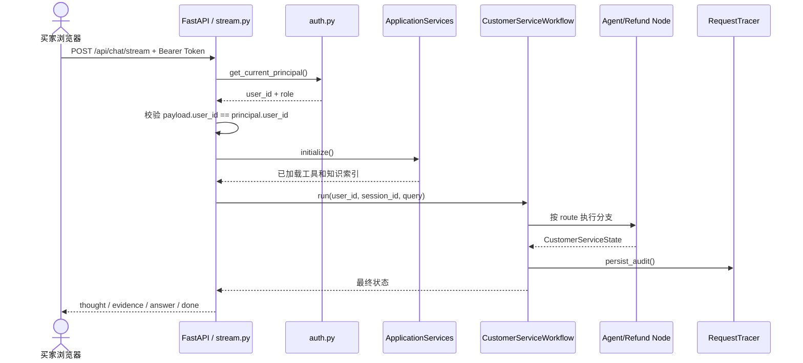

# 环节 1：入口与一次请求的全局生命周期

这一环先不要钻进算法。目标是回答：“用户发出一句话后，系统经过哪些边界，最终把什么返回给浏览器？”

## 推荐阅读顺序

1. [`newcode/main.py`](../../newcode/main.py) 第 27–84 行：应用启动、路由注册、静态页面。
2. [`newcode/services/runtime.py`](../../newcode/services/runtime.py) 第 20–76 行：进程级依赖如何组装。
3. [`newcode/api/routes/stream.py`](../../newcode/api/routes/stream.py) 第 25–183 行：鉴权后的请求如何调用工作流并转换为 SSE。
4. [`newcode/schemas/common.py`](../../newcode/schemas/common.py) 第 9–82 行：网络边界上的请求、响应和事件契约。
5. 最后只浏览 [`newcode/workflow/graph.py`](../../newcode/workflow/graph.py) 第 31–94 行，先认识总调度，不追分支细节。

## 全局调用关系图



## 阅读时抓住四个边界

### 1. 启动边界

`lifespan()` 在服务启动时验证鉴权配置、建表并初始化共享服务。`ApplicationServices` 是简易的 composition root：它创建一个共享 RAG 索引、工具注册表、问题池服务和工作流实例。

重点不是单例写法本身，而是它带来的生命周期含义：RAG 索引和 `workflow.sessions` 都跟随当前 Python 进程存在。

### 2. 身份边界

接口不相信请求体里的 `user_id`。它先从签名 Token 得到 `AuthenticatedPrincipal`，再要求请求体身份与 Token 身份一致，最后把 `principal.user_id` 交给工作流。后续工具查询又会做资源属主校验。这是两层防御：入口防身份替换，资源层防 IDOR。

### 3. 工作流边界

HTTP 层只负责协议转换与异常映射，不决定“该查订单还是查政策”。核心决策都交给 `CustomerServiceWorkflow.run()`，它返回统一的 `CustomerServiceState`。这个状态是 API 层和内部编排之间的主要契约。

### 4. 流式边界

当前 SSE 是“工作流执行完成后再分片发送”，不是模型边生成边传输：`workflow.run()` 先完整返回，然后答案每 32 个字符切片。理解这一点很重要，因为它影响首字延迟、取消请求和真正 Token Streaming 的后续设计。

## 你应该带着这些问题读

- 为什么 `ApplicationServices.initialize()` 在启动和请求路径都会调用？它通过锁和 `_initialized` 如何保证幂等？
- 如果部署 4 个 worker，`workflow.sessions` 和内存 RAG 索引会有几份？
- SSE 的 `thought`、`evidence`、`answer`、`done` 分别来自状态的哪些字段？
- `IDORForbiddenException` 在流式接口与同步接口中分别如何表达？

## 小练习

不改代码，手工追踪请求“查询订单 ord_1001”的调用路径，至少写出以下节点：

```text
chat_stream_post -> stream_event_generator -> workflow.run
-> execute_agent_node -> ToolRegistry.execute -> QueryOrderTool.execute
-> CustomerServiceState -> SSE events
```

然后再追踪“7 天无理由退货的要求是什么？”，比较它在哪个节点开始走不同分支。

## 完成标准

当你能不看代码解释以下内容，本环节就完成了：应用如何启动、身份从哪里来、核心工作流在哪里、返回事件如何组成，以及当前“流式”的真实含义。

## 证据与边界

- **Fact：** 共享依赖在 `ApplicationServices` 中创建，知识索引只初始化一次。
- **Fact：** SSE 在工作流完成后才把 `final_answer` 按 32 字符切片。
- **Inferred：** 设计希望 API 层保持轻薄，把 Agent 决策集中在工作流层。
- **Unknown：** 生产环境是否使用多 worker、会话粘滞或外部会话存储，仓库中没有部署配置可证明。

