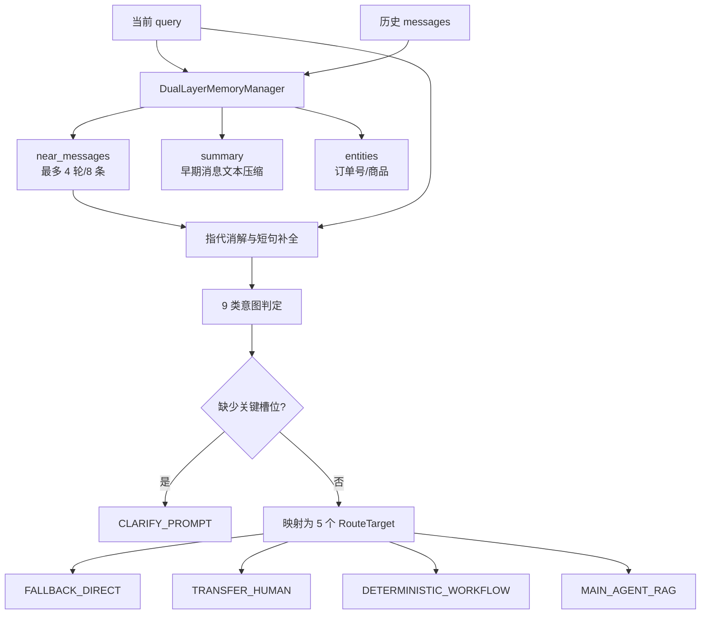

# 环节 2：状态、记忆与路由——Agent 如何“理解”问题

这一环学习 Agent 的决策输入。先看它携带什么状态，再看上下文如何缩短，最后看自然语言如何被归到有限的执行出口。

## 推荐阅读顺序

1. [`newcode/workflow/state.py`](../../newcode/workflow/state.py) 第 11–33 行：统一状态容器。
2. [`newcode/schemas/intent.py`](../../newcode/schemas/intent.py) 第 10–37 行：9 类意图与 5 个路由出口。
3. [`newcode/services/memory.py`](../../newcode/services/memory.py) 第 20–81 行：近端窗口、远端摘要、实体提取。
4. [`newcode/services/router.py`](../../newcode/services/router.py) 第 27–177 行：改写、槽位检查、意图分类和路由映射。
5. [`tests/test_intent_router.py`](../../tests/test_intent_router.py) 和 [`tests/test_guard_memory.py`](../../tests/test_guard_memory.py)：从样例确认规则边界。

## 从原始消息到执行路线

## 先理解状态，而不是先理解函数

`CustomerServiceState` 同时承载四类信息：

- 身份与输入：`user_id`、`session_id`、`query`；
- 理解结果：`rewritten_query`、`intent`、`route`；
- 可恢复业务状态：`order_id`、`refund_status`、`is_suspended`；
- 执行产物：证据、工具调用、置信度、思考摘要和最终答案。

这是一种“共享黑板”式编排：节点读取并更新同一个状态对象。优点是流程直观，缺点是字段越来越多时，节点间隐式耦合会增加。

## 记忆的真实实现

`DualLayerMemoryManager` 的近期记忆保留最近 8 条消息。更早消息被拼接为文本摘要，并提取订单号和商品名。但是在当前主工作流中，路由器只接收 `near_messages`；生成出的 `summary` 和 `entities` 没有写回 `CustomerServiceState`，也没有传给后续节点。

因此“具备双层记忆组件”是事实，但“主链路完整使用远端记忆”不是当前代码能证明的事实。这是学习现有系统时很典型的差异：组件存在不等于能力已经接通。

## 路由的决策优先级

路由不是 LLM 分类，而是按固定顺序匹配关键词：

优先级本身就是业务逻辑。例如一句话同时包含“退款”和“物流”，会先落到退款还是物流，取决于这段顺序。阅读时不要只看关键词表，也要看判定次序。

## 9 类意图为什么要收敛成 5 个出口

意图用于描述“用户想做什么”，路由用于描述“系统应该如何执行”。多个意图可以共享同一种执行机制：商品咨询和政策问答都可以进入 RAG；闲聊和违规输入都能进入直接回复，但内部回答不同。这样可以减少执行分支数量。

## 小练习

对下面四句话，先不运行代码，预测 `rewritten_query / intent / route / missing_slots`，再到测试或 REPL 验证：

1. “它保修多久？”（历史中刚提到“蓝牙耳机”）
2. “能退吗？”（无历史）
3. “物流到哪了？”（无订单号）
4. “我要投诉退款太慢了”

特别观察第 3 句：路由阶段可能进入 `MAIN_AGENT_RAG`，但 Agent 节点会因缺订单号再次挂起。这说明槽位检查分散在路由层和执行层。

## 完成标准

你应该能够从任意一句用户输入，解释它如何被改写、为什么命中某个意图、为何映射到某个执行出口，以及哪些上下文实际参与了判断。

## 证据与边界

- **Fact：** 当前路由器是确定性关键词与正则规则，没有调用 LLM。
- **Fact：** 会话键由 `(user_id, session_id)` 组成，避免不同用户共享同名会话。
- **Fact：** `summary` 和 `entities` 由记忆组件生成，但主工作流未消费它们。
- **Inferred：** 9→5 的收敛是在业务语义和执行机制之间建立隔离层。
- **Unknown：** 产品期望的真实意图分布、冲突优先级和多语言需求不在仓库证据内。

