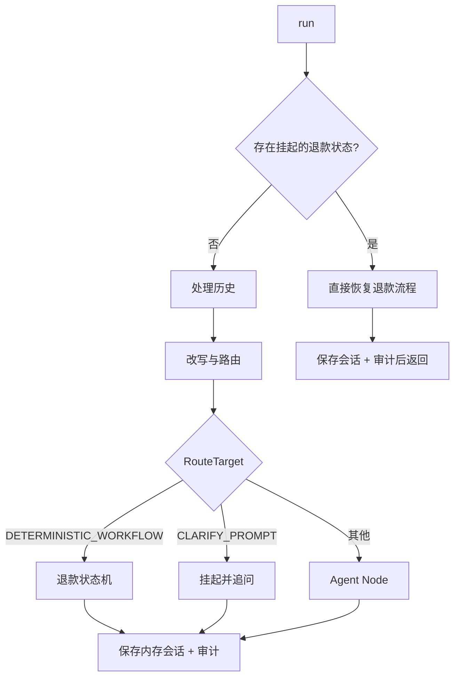
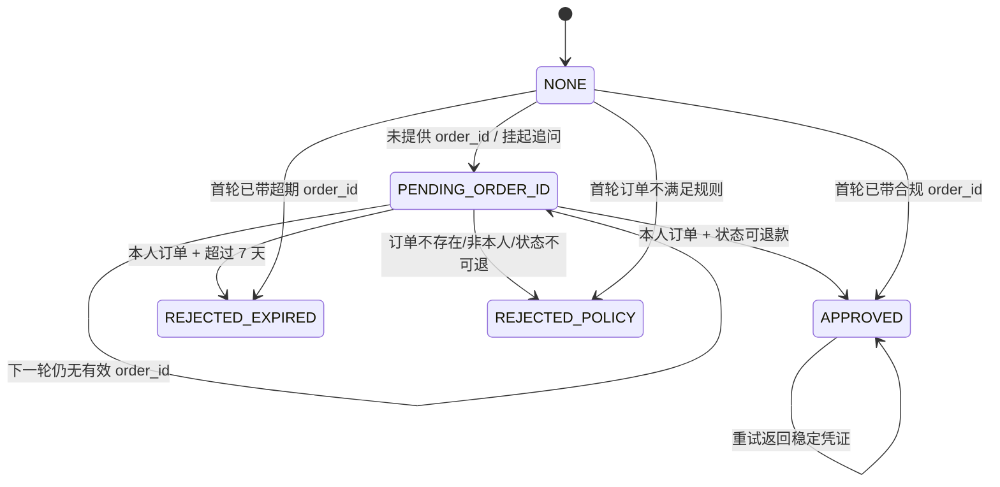
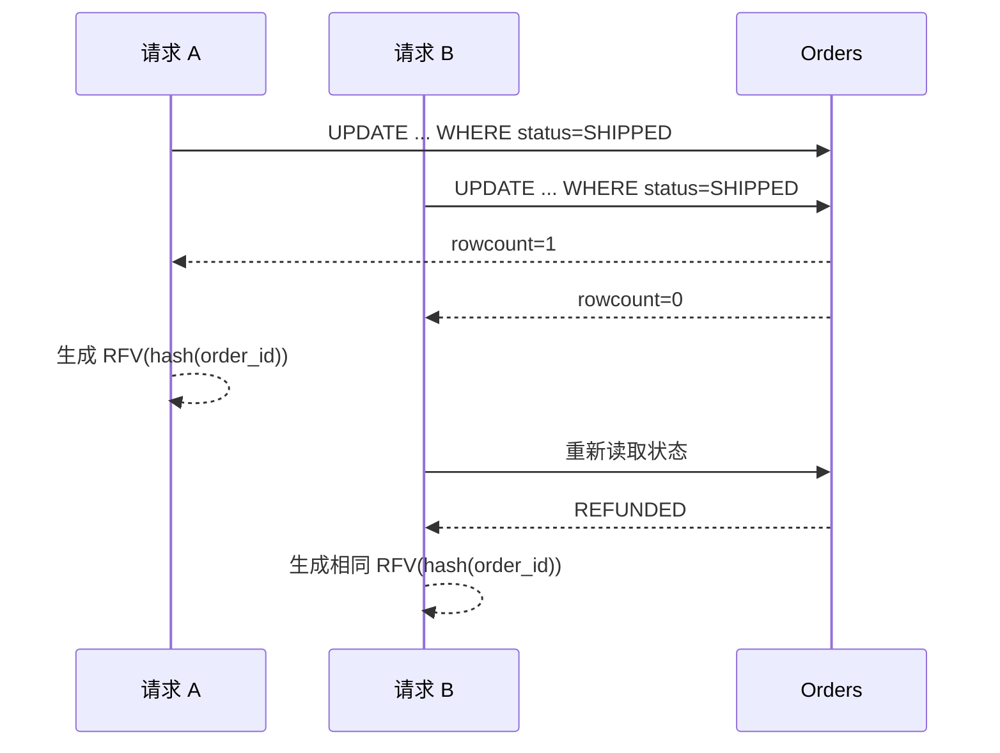

# 环节 3：编排与确定性工作流——把业务承诺交给代码

这一环是 SureDesk Agent 思想的核心：不是所有问题都交给“智能回答”。退款会改变真实订单状态，因此由确定性状态机负责，Agent 只能把请求送到它那里。

## 推荐阅读顺序

1. [`newcode/workflow/graph.py`](../../newcode/workflow/graph.py) 第 17–94 行：总编排入口和分支。
2. [`newcode/workflow/state.py`](../../newcode/workflow/state.py) 第 20–25 行：退款相关状态槽位。
3. [`newcode/workflow/nodes/refund_workflow.py`](../../newcode/workflow/nodes/refund_workflow.py) 第 16–138 行：挂起、恢复、鉴权、规则与幂等。
4. [`newcode/workflow/nodes/agent_node.py`](../../newcode/workflow/nodes/agent_node.py) 第 18–113 行：非退款分支如何继续执行。
5. [`tests/test_workflow.py`](../../tests/test_workflow.py)：重点看挂起恢复、超期拒绝、并发幂等、跨用户会话隔离。

## 编排器的分支结构

## 退款状态机

## 为什么退款不走自由生成

退款包含至少三种不可由语言模型猜测的事实：订单是否存在、是否属于当前用户、状态是否允许退款。并且成功会写数据库。`execute_refund_workflow()` 直接查询订单并执行条件更新，把“能否退款”变成可测试的代码规则。

这体现了一个重要 Agent 设计原则：**模型可以提出动作意图，但有副作用的动作必须经过确定性验证和授权边界。**

## 挂起与恢复

缺少订单号时，状态设置为 `PENDING_ORDER_ID` 和 `is_suspended=True`。下一轮只要相同 `(user_id, session_id)` 进入，编排器会绕过重新分类，直接把新输入交给退款流程。这使多轮对话成为可恢复流程，而不是两次互不相关的聊天。

当前挂起状态保存在进程内字典，不是数据库检查点。因此重启、横向扩容或 worker 切换会丢失/分裂状态。学习时应把“状态机逻辑正确”和“状态持久化达到生产级”分开判断。

## 幂等边界

退款更新使用“订单 ID + 原状态”的条件更新。并发请求中只有一个能从原状态更新为 `REFUNDED`；另一个刷新后看到已退款，也返回同一凭证。凭证由 `sha256(order_id)` 派生，所以重试不会产生第二个退款身份。

## 注意“LangGraph”名称与运行事实

文件和文档称它为 LangGraph Workflow，但项目依赖中没有 `langgraph`，代码中也没有 `StateGraph`、节点注册或图编译。当前实现是一个自定义异步 Python 编排器。这个命名不妨碍理解其图式设计，但不要误以为已经具备 LangGraph 的 checkpoint、interrupt、持久化或图运行时能力。

## 小练习

按以下三条路径逐行记录状态字段变化：

1. “我想退款” → “ord_wf_1”；
2. “退款 ord_wf_expired”；
3. 两个并发请求同时退款同一订单。

对每一步写下：读取了哪些字段、修改了哪些字段、是否访问数据库、是否产生副作用、可否安全重试。

## 完成标准

你能够解释为什么退款需要独立工作流，挂起状态如何恢复，跨用户为什么不能恢复同一会话，以及数据库条件更新如何构成幂等边界。

## 证据与边界

- **Fact：** 当前编排器是自定义 Python 类，不是 LangGraph 运行时。
- **Fact：** 退款状态通过内存字典保存，键包含用户和会话。
- **Fact：** 退款写入使用条件更新，并发测试验证两次请求返回相同凭证。
- **Inferred：** 设计希望形成“开放理解 + 受控执行”的混合 Agent。
- **Unknown：** 实际支付系统是否需要独立退款事务、外部幂等键和补偿机制，仓库未实现。

