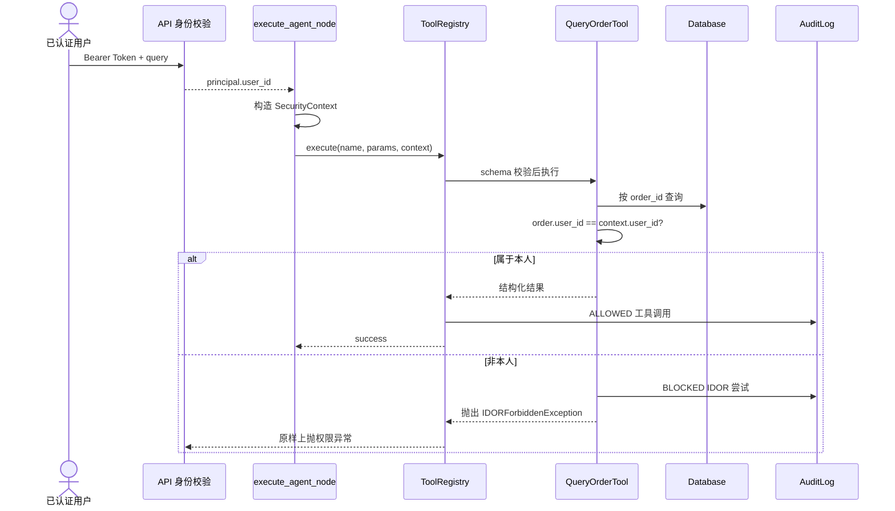
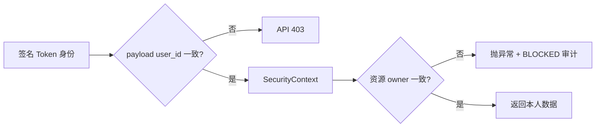

# 环节 4：工具系统与安全边界——Agent 能做什么、以谁的身份做

Agent 的能力不是来自回答文字，而是来自可调用的工具。这个环节关注三个问题：工具如何声明、如何执行、谁有权执行。

## 推荐阅读顺序

1. [`newcode/tools/base.py`](../../newcode/tools/base.py) 第 12–50 行：`SecurityContext`、工具抽象和 OpenAI Tool Schema。
2. [`newcode/tools/registry.py`](../../newcode/tools/registry.py) 第 13–64 行：注册、超时、执行与审计。
3. [`newcode/tools/order_tools.py`](../../newcode/tools/order_tools.py) 第 14–93 行：订单查询和用户范围查询。
4. [`newcode/tools/logistics_tools.py`](../../newcode/tools/logistics_tools.py) 第 16–66 行：物流查询的属主校验。
5. [`newcode/tools/mcp_adapter.py`](../../newcode/tools/mcp_adapter.py) 第 11–29 行：外部工具适配契约。
6. [`newcode/api/auth.py`](../../newcode/api/auth.py) 第 21–127 行：身份如何从签名 Token 进入系统。
7. [`tests/test_tools.py`](../../tests/test_tools.py) 与 [`tests/test_api_auth_integration.py`](../../tests/test_api_auth_integration.py)：验证允许和拒绝路径。

## 工具调用的信任链

## 工具契约的四层

### 1. 描述层

`name`、`description` 和 `parameters_schema` 说明工具叫什么、做什么、需要什么参数。`to_openai_tool()` 能转换成 Function Calling 格式，为未来由模型选择工具预留接口。

### 2. 参数层

具体工具使用 Pydantic 模型验证参数。例如 `QueryOrderParams` 要求 `order_id`。参数校验发生在工具内部，避免调用者绕过。

### 3. 身份层

`SecurityContext` 不是模型生成的参数，而是由受信任应用代码根据认证主体构造。把业务参数与安全上下文分开，是工具安全的关键：模型可以建议查哪个订单，但不能声明自己是谁。

### 4. 执行层

`ToolRegistry` 负责查找工具、设置超时并记录成功审计；具体工具负责资源级权限。注册表不知道“订单归谁”，订单工具才知道。这是基础设施职责与领域职责的分离。

## 两层 IDOR 防御

只在 API 层校验用户 ID 不够，因为攻击者仍可能提交别人的 `order_id`。因此工具层必须重新校验资源属主。这也说明权限检查要靠近数据访问位置。

## 当前“Agent 工具调用”的真实边界

`execute_agent_node()` 不是让 LLM 自主选择任意工具，而是根据已分类意图和正则是否提取到订单号，确定性选择 `query_order`、`list_user_orders` 或 `query_logistics`。注册表虽然能导出 OpenAI Tool Schema，但主链路没有把该 Schema 发送给 LLM。

MCP 适配器同样只是一个通用包装类；`ApplicationServices` 当前只注册三个本地工具，没有注册外部 MCP 工具。

## 小练习

选择 `query_order`，从 API 到数据库列出每一处输入校验与错误出口。然后思考新增“取消订单”工具时，哪些检查属于：

- API 身份层；
- Tool Registry 通用层；
- 取消订单领域规则；
- 数据库幂等层。

不要急着写代码，先画出信任边界。

## 完成标准

你能够说明为什么 `SecurityContext` 不能来自模型、权限为何要在工具内部再次验证、注册表和具体工具各自负责什么，以及当前工具选择为何仍属于确定性路由。

## 证据与边界

- **Fact：** 工具参数通过 Pydantic 验证，注册表提供超时和成功审计。
- **Fact：** 跨用户订单/物流访问会记录 BLOCKED 审计并抛出专门异常。
- **Fact：** 主链路没有执行由 LLM 返回的 tool calls，MCP 适配器也未被运行时注册。
- **Inferred：** `to_openai_tool()` 和 `MCPToolAdapter` 是为以后接入模型驱动工具选择预留的扩展点。
- **Unknown：** 外部 MCP 服务的认证、重试、幂等与数据分级策略尚无仓库证据。

