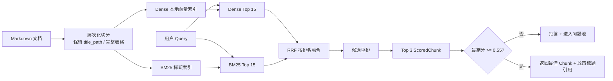

# 环节 5：RAG 与置信度闸门——有证据才回答

这一环学习 SureDesk 如何处理政策类问题。核心不是“搜索到一段文字”，而是理解从文档切分、双路召回、融合、重排到拒答的完整证据链。

## 推荐阅读顺序

1. [`knowledge_base/ecommerce_faq.md`](../../knowledge_base/ecommerce_faq.md)：先认识被检索的原始知识。
2. [`newcode/rag/chunking.py`](../../newcode/rag/chunking.py) 第 12–155 行：Markdown 如何变成 Chunk。
3. [`newcode/rag/dense.py`](../../newcode/rag/dense.py) 第 12–62 行与 [`newcode/rag/bm25.py`](../../newcode/rag/bm25.py) 第 11–51 行：两条召回通道。
4. [`newcode/rag/fusion.py`](../../newcode/rag/fusion.py) 第 7–24 行：RRF 如何按名次融合。
5. [`newcode/rag/reranker.py`](../../newcode/rag/reranker.py) 第 10–47 行：候选如何重排。
6. [`newcode/rag/engine.py`](../../newcode/rag/engine.py) 第 25–91 行：总管线。
7. [`newcode/guard/confidence_gate.py`](../../newcode/guard/confidence_gate.py) 第 19–60 行：生成前证据门槛。
8. 回到 [`newcode/workflow/nodes/agent_node.py`](../../newcode/workflow/nodes/agent_node.py) 第 76–110 行：检索结果如何变成最终答案。

## 完整检索管线



## 第一步：知识不是整篇塞给模型

`HierarchicalMarkdownChunker` 维护标题栈，把标题路径写进每个 Chunk；表格单独成块，避免行被拆散。检索时标题和正文一起参与打分，因此“售后政策 > 7 天退货”本身也提供语义信号。

注意构造函数有 `overlap` 参数，但当前长文本切分逻辑没有使用重叠窗口。大段落也不会按句子继续细分，只按空行分段。这些都是阅读实现后才能看到的真实边界。

## 第二步：双路召回解决不同问题

- BM25 关注词项匹配，适合订单术语、政策名称和精确关键词。
- `DenseRetriever` 希望覆盖语义相近表达，减少只靠原词命中的限制。

RRF 不直接比较两路分数，因为 Dense 相似度和 BM25 分数不在同一量纲。它只看每个候选在各列表中的名次：

```text
RRF(doc) = Σ 1 / (k + rank_i(doc))
```

同时被两路排在前面的文档会获得更高融合分。

## 第三步：重排分数也是安全信号

重排器计算 Query 覆盖率、Jaccard 重叠和标题命中奖励，输出 0–1 分数。`ConfidenceGate` 读取最高分：没有结果或低于阈值就拒答，避免把弱相关内容包装成确定政策。

这里体现的是“先证明，再生成”：生成器不能绕过证据门槛。即使未来换成真正 LLM，这个门槛也应作为独立策略层保留。

## 当前实现与名称的差异

理解这一段非常重要：

- `DenseRetriever` 没有调用 Embedding 模型，而是用 Python `hash()` 和 n-gram 生成 128 维本地向量；Python 哈希默认可能随进程变化。
- `CrossEncoderReranker` 没有加载 Cross-Encoder 模型，而是词项重叠启发式打分。
- 通过闸门后没有调用 LLM 生成答案，而是直接返回最佳 Chunk 的全文并附标题引用。

因此当前系统是一条可离线运行、容易测试的“检索式回答管线”，而不是完整的生成式 RAG。文件命名表达了目标架构，但学习时必须按代码事实理解。

## 如何阅读评测结果

[`docs/RAG_EVALUATION.md`](../RAG_EVALUATION.md) 显示样本上 BM25 的 MRR 为 1.0000，而 Hybrid 为 0.9500。也就是说当前报告并不能支持“Hybrid 全面优于单路召回”的宽泛结论；它只显示 Hybrid 比报告中的 Dense MRR 高，同时低于 BM25。阅读 Agent 项目时，要看指标表本身，不只看结论文字。

## 小练习

手算一个两路排名示例：

- Dense：A 第 1、B 第 2、C 第 3；
- BM25：B 第 1、D 第 2、A 第 3；
- 令 `k=60`。

算出 A、B 的 RRF 分数并解释为什么 B 更高。然后任选知识库中的一个问题，从 `title_path`、正文词项和 Query 覆盖率推测哪个 Chunk 会通过闸门。

## 完成标准

你能够画出文档到答案的完整证据链，解释 BM25、Dense、RRF、重排和 Gate 各自解决的问题，并准确说明当前实现哪些是启发式模拟、哪些是真正的模型能力。

## 证据与边界

- **Fact：** 检索使用两路召回、RRF 融合、启发式重排和 0.55 默认阈值。
- **Fact：** 当前在线回答直接使用最佳 Chunk 内容，没有经过 `LLMClient`。
- **Fact：** 评测报告中 BM25 的 MRR 高于 Hybrid。
- **Inferred：** 这套本地算法优先追求离线可重复测试和零外部依赖，而不是最强语义能力。
- **Unknown：** 0.55 阈值是否经过真实业务数据校准，仓库没有精确率/召回率与拒答成本曲线。

