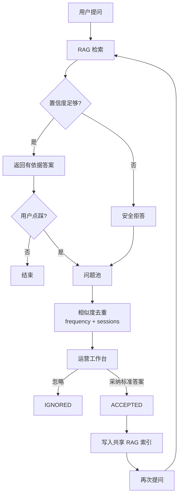
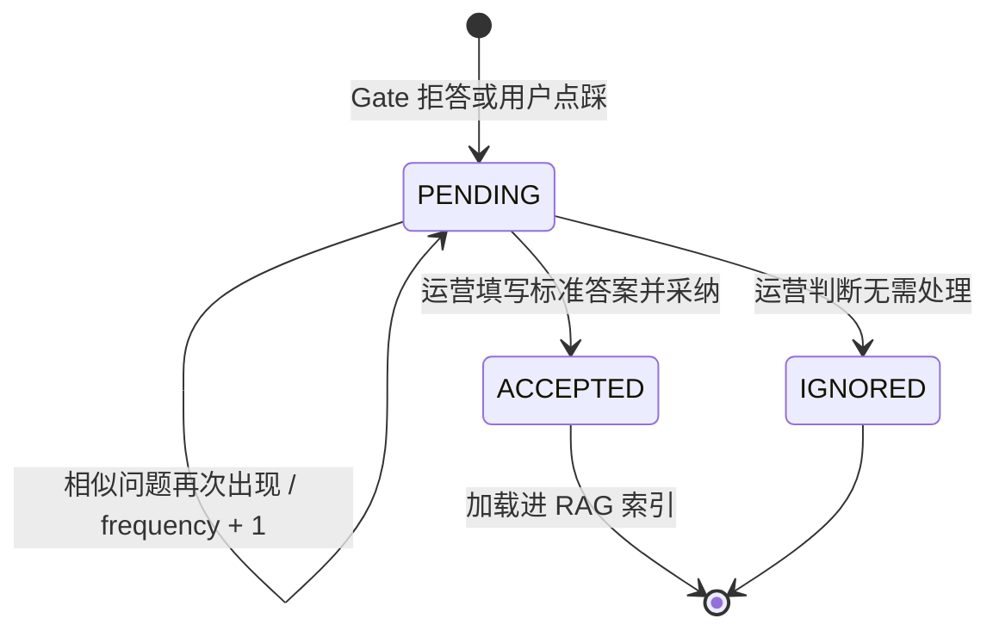

# 环节 6：数据飞轮与可观测性——让“不知道”成为下一轮知识

一个成熟 Agent 不只要回答问题，还要处理“无法回答”和“答错了”。SureDesk 把这些失败沉淀到问题池，由运营审核后回流知识索引，形成最小的数据飞轮。

## 推荐阅读顺序

1. [`newcode/services/problem_pool.py`](../../newcode/services/problem_pool.py) 第 18–114 行：相似问题合并、待审状态和采纳回流。
2. [`newcode/models/domain.py`](../../newcode/models/domain.py) 第 57–74、251–303 行：触发类型、审核状态、问题池和审计日志。
3. [`newcode/api/routes/feedback.py`](../../newcode/api/routes/feedback.py) 第 19–59 行：用户点踩入口。
4. [`newcode/api/routes/workbench.py`](../../newcode/api/routes/workbench.py) 第 37–125 行：运营列表、采纳、忽略。
5. [`newcode/services/runtime.py`](../../newcode/services/runtime.py) 第 38–73 行：启动时重新装载已采纳知识。
6. [`newcode/core/tracing.py`](../../newcode/core/tracing.py) 第 15–84 行：请求 Span 与审计持久化。
7. [`tests/test_e2e_flywheel.py`](../../tests/test_e2e_flywheel.py)：按完整闭环顺序阅读。

## 数据飞轮全链路

## 问题池如何减少噪声

`add_or_merge_problem()` 只扫描待处理问题，用字符/单词集合的 Jaccard 相似度判断是否合并。超过阈值时增加 `frequency`，并记录新的 `session_id`。这使运营可以优先处理高频未知问题，而不是面对大量重复记录。

它的限制也很清楚：集合相似度忽略词序和语义，且每次新增都扫描全部待审问题，数据量大后需要索引或近邻检索。

## 审核回流为什么要有人

低置信问题不自动让模型编答案，而是要求具备 Operator/Admin 角色的人写入 `standard_answer`。采纳后同时更新数据库状态和当前进程的 RAG 索引；服务重启时，`ApplicationServices.initialize()` 会重新读取已采纳答案并建索引。

这是 Human-in-the-loop 的最小实现：人负责确认知识，机器负责发现缺口、聚合频次和快速分发。

## 状态与数据关系

## 可观测性在当前系统中的位置

`RequestTracer` 为路由、Agent 执行或退款恢复创建 Span，并把时延、路由元数据和证据数量写入 `AuditLog`。工具调用也写审计日志，IDOR 拦截则写 BLOCKED 记录。

不过当前主链路没有调用 `set_tokens()`；`to_dict()` 只持久化 `evidence_count`，没有把 `evidence_snapshot` 本身放进审计详情。因此 README 中“Token 消耗与证据快照”的描述只部分落地。

## 三种触发器的接线状态

领域枚举声明了三类触发：`CONFIDENCE_GATE`、`SELF_EVAL_FAIL`、`USER_THUMBS_DOWN`。当前可以在主链路找到前置 Gate 和用户点踩的实际入口，但没有找到生成后自评失败的执行器或调用路径。它目前是模型字段支持，而非完整功能链路。

## 小练习

从测试里的“碎屏险”问题出发，记录它经历的每个持久化/内存边界：

1. 第一次提问为什么被拒；
2. 问题池保存哪些字段；
3. 运营采纳时哪些数据进入数据库，哪些进入内存索引；
4. 服务重启后标准答案如何重新进入索引；
5. 第二次提问为什么可以通过 Gate。

## 完成标准

你能够解释未知问题如何被发现、去重、审核和回流；同时能指出问题池数据、RAG 内存索引、会话内存和审计日志分别由谁持有、何时持久化。

## 证据与边界

- **Fact：** Confidence Gate 拒答和用户点踩已接入问题池。
- **Fact：** 采纳答案会立即加入共享内存索引，启动时也会重载数据库中的已采纳答案。
- **Fact：** `SELF_EVAL_FAIL` 只有枚举/服务支持，未见主链路触发。
- **Fact：** Trace 当前持久化证据数量，不持久化证据内容；Token 计数器未在工作流中更新。
- **Inferred：** 数据飞轮把“拒答”从失败结果转化成知识建设队列。
- **Unknown：** 运营审核 SLA、答案版本治理、撤回机制和知识冲突策略没有实现证据。

