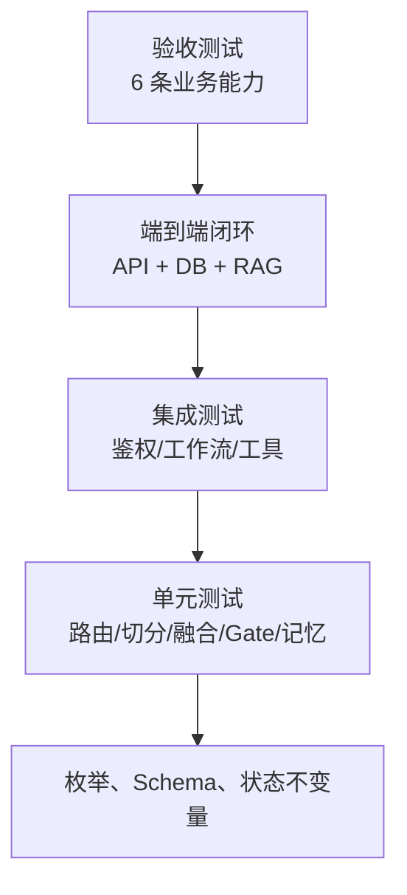
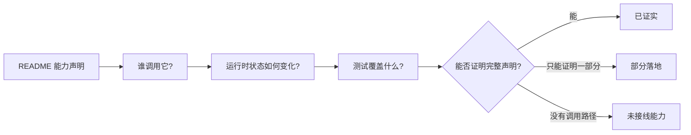

# 环节 7：用测试反向验证 Agent 设计

最后一个学习环节不再增加新模块，而是用测试验证前六环建立的心智模型。测试是这个项目中比注释更可靠的行为合同。

## 推荐测试顺序

不要直接全量运行后只看“通过”。按设计层次逐组阅读和执行：

| 顺序 | 测试 | 验证的设计问题 |
|---:|---|---|
| 1 | `tests/test_intent_router.py` | 自然语言如何收敛为有限路由？ |
| 2 | `tests/test_guard_memory.py` | 记忆窗口和证据门槛是否符合预期？ |
| 3 | `tests/test_workflow.py` | 挂起恢复、硬规则、并发幂等是否成立？ |
| 4 | `tests/test_tools.py` | 工具契约、超时边界、IDOR 是否成立？ |
| 5 | `tests/test_retrieval.py` | 切分、召回、融合、重排每层是否可独立验证？ |
| 6 | `tests/test_problem_pool_trace.py` | 问题池去重和审计持久化是否成立？ |
| 7 | `tests/test_api_auth_integration.py` | 外部身份能否穿透到正确的安全上下文？ |
| 8 | `tests/test_e2e_flywheel.py` | 未知问题到知识回流的闭环是否成立？ |
| 9 | `tests/test_full_acceptance.py` | 六项验收标准是否有端到端证据？ |

## 测试金字塔对应系统结构



从下往上读，你会看到“算法是否正确”如何逐层变成“业务能力是否成立”。从上往下读，则能从验收目标快速定位实现和缺失的测试层。

## 建议执行命令

项目已经有 `.venv`，遵循仓库约定优先使用它：

```bash
.venv/bin/pytest tests/test_intent_router.py tests/test_guard_memory.py -q
.venv/bin/pytest tests/test_workflow.py tests/test_tools.py -q
.venv/bin/pytest tests/test_retrieval.py tests/test_problem_pool_trace.py -q
.venv/bin/pytest tests/test_api_auth_integration.py tests/test_e2e_flywheel.py -q
.venv/bin/pytest tests/test_full_acceptance.py -q
```

最后再运行：

```bash
.venv/bin/pytest tests/ -q
```

### 一个真实的非确定性案例

如果全量测试偶发地只有 `test_dense_retriever` 失败，不要立刻把它当作环境噪声。当前 `simple_semantic_vector()` 使用 Python 内置 `hash()`，而哈希盐默认会随进程变化，所以“物流”问题的 Top 1 Chunk 可能在不同进程中改变。固定哈希种子后可以复现稳定结果：

```bash
env PYTHONHASHSEED=0 .venv/bin/pytest tests/ -q
```

这不是理想的长期修复；它只是诊断证据。真正的改进应使用跨进程稳定的哈希或真实 Embedding，并为排名稳定性增加回归测试。这个例子展示了测试的另一价值：不仅验证功能，还会暴露实现与“可重复检索”这一隐含不变量之间的冲突。

## 用四列表读每个测试

阅读一个测试时，自己写一个四列表：

| Given（初始状态） | When（触发动作） | Then（可观察结果） | Side effect（副作用） |
|---|---|---|---|
| 本人订单为 `SHIPPED` | 同会话发起退款 | `refund_status=APPROVED` | 订单变为 `REFUNDED`、写 Trace |
| 他人订单存在 | 调用 `query_order` | 抛 `IDORForbiddenException` | 写 BLOCKED AuditLog |
| 知识索引无命中 | Gate 评估 | 返回标准拒答 | 新增/合并 ProblemPool |

这样能防止只记住断言，而忽略状态和副作用。

## 重点做一次“反证式阅读”

挑选 README 的一项能力声明，查找它的调用者和测试。例如“真实 SSE 流式输出”：



用这个方法你会发现：LLM Client 的单元测试证明封装可用，但没有证明在线工作流调用 LLM；SSE 测试证明事件协议可用，但不等于模型 Token 实时流式；LangGraph 名称也没有对应运行时依赖。

## 最终心智模型复述

完成所有测试后，尝试用不超过 10 句话复述项目：

1. API 从签名 Token 建立可信身份。
2. 记忆组件截取近期上下文，路由器以规则改写并分类。
3. 9 类意图收敛到 5 类执行机制。
4. 退款进入可挂起恢复的确定性流程。
5. 订单/物流进入带安全上下文的工具。
6. 政策问题进入混合检索和证据闸门。
7. 证据不足则拒答并进入问题池。
8. 运营采纳答案后更新 RAG 索引。
9. Trace 与工具审计提供部分可观测性。
10. 当前核心仍是确定性编排，LLM/真实 LangGraph 尚未接入主链路。

如果你能针对每句话指出代码和测试证据，就已经掌握了当前 Agent 设计。

## 完成标准

你可以从一个验收用例反向定位到 API、状态、分支、数据副作用和底层单元测试；也能识别“组件存在”“主链路接通”“端到端被证明”三者的差别。

## 证据与边界

- **Fact：** 测试覆盖路由、工作流、工具、RAG、问题池、鉴权和闭环。
- **Fact：** LLM Client 有独立单元测试，但没有在线工作流集成测试。
- **Inferred：** 该项目最适合以“测试—调用者—实现”三角方式学习，而不是只读 README。
- **Unknown：** 当前测试能否代表真实客服流量，需要生产数据或更大离线数据集才能判断。
