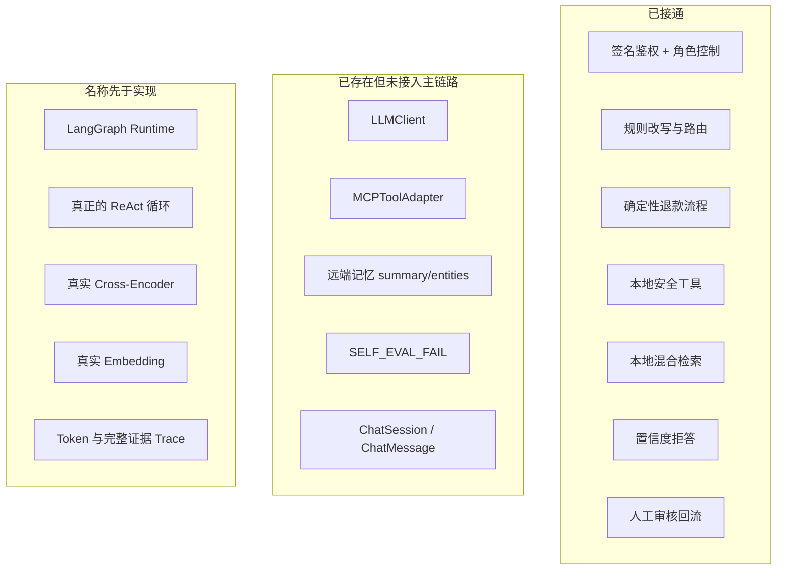
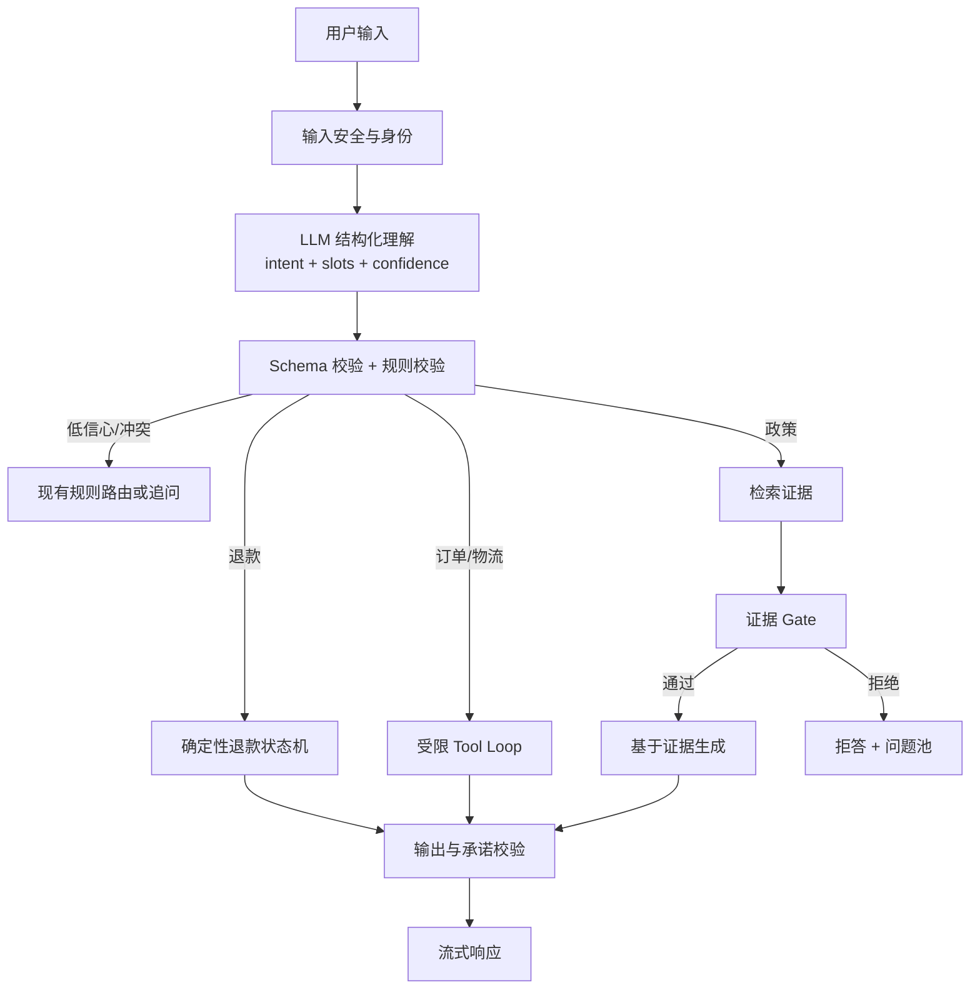

# 下一步展望：从确定性原型走向可信 Agent

完成前七环后，应把 SureDesk 看成一个“安全边界清晰、流程可测试的 Agent 骨架”，而不是已经完成的生产级生成式 Agent。下一步提升不应先追求更复杂的 Prompt，而应按可靠性、智能化、质量闭环的顺序推进。

## 当前能力基线

## 优先级 1：先把运行状态变成可靠事实

目标：多进程、重启、并发情况下行为仍一致。

建议工作：

1. 把 `workflow.sessions` 从进程内字典迁移到数据库/Redis checkpoint，并以 `(user_id, session_id)` 建唯一隔离键。
2. 真正使用 `ChatSession` 和 `ChatMessage`，持久化用户、助手、工具消息与工作流 checkpoint。
3. 引入数据库迁移工具，不再依赖启动时 `create_all()` 演进生产 Schema。
4. 把退款动作封装成领域服务；对接支付系统时使用外部幂等键、事务日志和补偿状态，而不是仅更新订单表。
5. 为共享 RAG 索引设计版本、刷新和多实例一致性机制。

验收信号：进程重启后能恢复挂起退款；两个 worker 可继续同一会话；同一外部退款请求不会重复扣付。

## 优先级 2：接入 LLM，但保留确定性护栏

目标：让模型提升理解与表达，不让它获得未经约束的业务权限。

推荐目标架构：

实施要点：

- 用 Pydantic 结构化输出接入 `LLMClient.generate_structured()`，但保留现有规则分类器作为降级和交叉校验。
- 如果实现 ReAct，限制允许工具、最大步数、总超时和参数 Schema；`SecurityContext` 永远由服务端注入。
- 模型只提出退款意图，不能直接写订单；确定性工作流仍是最终授权者。
- 生成回答必须绑定检索证据，输出后检查引用、金额、时限等高风险承诺。
- 只有需要 checkpoint、interrupt、并行分支和图可视化时再引入 LangGraph；不要仅为名称一致而增加框架。

验收信号：复杂表达和多轮指代准确率提升，同时 IDOR、超期退款、工具参数与拒答率不退化。

## 优先级 3：升级检索并校准置信度

目标：把启发式 RAG 升级成可度量的语义检索系统。

建议工作：

1. 使用稳定的中文/多语言 Embedding，并把向量持久化到适合规模的索引。
2. 接入真正的 Cross-Encoder 或高质量 rerank API；保存模型版本与打分分布。
3. 修正 Chunk overlap，增加文档 ID、版本、有效期、业务域和权限元数据。
4. 扩大评测集，按政策、商品、订单问法、错别字和多轮省略分层；报告 Recall、MRR、nDCG、答案忠实度和拒答精确率。
5. 用验证集校准 Gate，而不是固定拍一个阈值；分别计算“错误放行”和“错误拒答”的业务成本。

验收信号：Hybrid 在目标数据上稳定优于各单路基线，且跨进程结果可复现；阈值变化有清晰的精确率/召回率曲线。

## 优先级 4：补齐可观测性、安全与评估

目标：可以回答“哪一步错了、影响谁、能否重放”。

建议工作：

- 为每次请求统一 correlation ID，记录模型、Prompt 版本、工具输入输出摘要、完整证据引用、Token、成本和取消状态。
- 对敏感字段做脱敏；AuditLog 和 Debug Trace 分库存储、分权限访问。
- 真正接入 `SELF_EVAL_FAIL`，但不要让同一模型自评成为唯一质量门槛；结合规则、引用一致性和抽样人工评审。
- 增加 Prompt 注入、越权工具选择、恶意 Chunk、超长输入、模型超时和 SSE 中断测试。
- 对问题池采纳答案做版本、审批人、发布时间、撤回与冲突检测。

验收信号：任一错误回答可以追到路由、证据、工具、模型版本和审核知识版本；安全回归能自动阻止发布。

## 优先级 5：让数据飞轮真正驱动产品

目标：不仅“收集失败”，还要证明修复带来质量提升。

建议工作：

1. 问题池按频次、用户影响、业务风险和置信度排序。
2. 相似问题用 Embedding 聚类替代全表 Jaccard 扫描。
3. 采纳前自动生成候选答案和引用，但由人确认；采纳后自动生成回归用例。
4. 建立“发现 → 审核 → 发布 → 回归 → 线上观察 → 撤回”的知识生命周期。
5. 跟踪覆盖率、拒答率、人工转接率、首次解决率、错误承诺率和每次解决成本。

## 推荐的实施批次

| 批次 | 范围 | 为什么先做 |
|---|---|---|
| A | 会话/checkpoint 持久化、迁移、退款幂等 | 没有可靠状态，智能化会放大风险 |
| B | LLM 结构化路由 + 证据生成，保留规则 fallback | 用最小接入获得理解与表达收益 |
| C | 真 Embedding/Reranker + 阈值校准 + 分层评测 | 让 RAG 名称与能力一致 |
| D | 受限 Tool Loop / 可选 LangGraph | 在护栏与评测成熟后增加自治性 |
| E | 全链路观测、知识版本与数据飞轮指标 | 支撑持续运营和安全迭代 |

## 不建议优先做的事

- 不要一开始就让模型自主调用所有工具。
- 不要用更长 Prompt 掩盖状态、权限或数据一致性问题。
- 不要只看“测试全绿”就宣称生产级；先确认测试证明了哪一层。
- 不要把离线组件的存在当作在线能力已接通。
- 不要为使用 LangGraph 而使用 LangGraph；先明确需要的运行时能力。

## 最终目标

理想的 SureDesk 不是“更像人地聊天”，而是：**理解更灵活、证据更可靠、动作更受控、失败可恢复、每次错误都能变成可验证的改进。** 当前代码已经把权限、确定性流程、证据 Gate 和人工回流这四个关键边界画出来；下一步要做的是让状态可靠持久化，再把真正的模型能力安全地接进这些边界。

## 证据与边界

- **Fact：** 当前 LLM、MCP、远端记忆、会话 ORM 和自评触发没有完整接入在线工作流。
- **Fact：** 当前路由、工具选择、退款和回答组装主要是确定性代码。
- **Inferred：** 最低风险的升级路线是“先可靠状态，再受控智能，最后提升自治”。
- **Unknown：** 真实流量规模、延迟预算、成本上限、合规要求和团队运维能力需要产品与部署信息才能确定。

