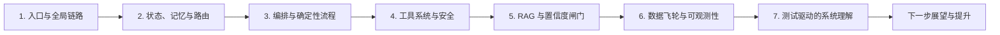
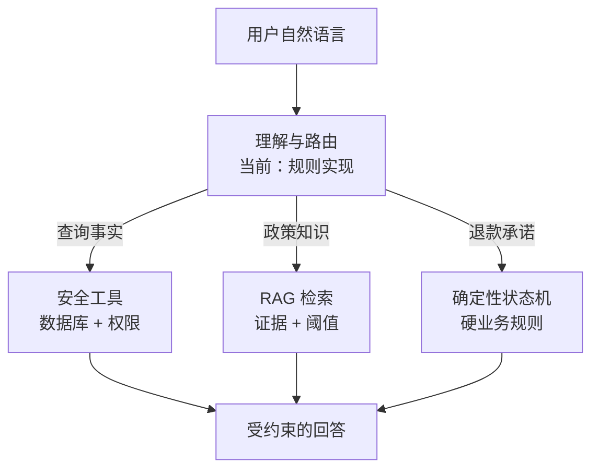

# SureDesk Agent 学习路线

这套材料不是按目录逐个解释文件，而是按一个客服 Agent 从“接收问题”到“持续变好”的生命周期来学习。目标是让你最终能够回答三个问题：

1. SureDesk 为什么把确定性业务规则、工具调用和知识问答分开？
2. 一次请求如何在身份、会话、路由、工具、RAG、状态机和审计之间流动？
3. 当前实现距离真正的 LLM Agent / LangGraph 系统还有哪些差距？

## 学习总图

## 推荐节奏

| 环节 | 预计时间 | 你会建立的能力 | 文档 |
|---|---:|---|---|
| 1 | 45–60 分钟 | 建立请求从 HTTP 到回答的全局地图 | [01-entry-and-request-lifecycle.md](01-entry-and-request-lifecycle.md) |
| 2 | 60–90 分钟 | 理解 Agent 的“感知与决策前处理” | [02-state-memory-and-routing.md](02-state-memory-and-routing.md) |
| 3 | 90 分钟 | 理解编排器、挂起恢复和硬规则边界 | [03-orchestration-and-deterministic-workflow.md](03-orchestration-and-deterministic-workflow.md) |
| 4 | 60–90 分钟 | 理解工具协议、权限上下文和越权防御 | [04-tools-and-security-boundary.md](04-tools-and-security-boundary.md) |
| 5 | 90–120 分钟 | 理解检索、融合、重排与生成前拒答 | [05-rag-and-confidence-gate.md](05-rag-and-confidence-gate.md) |
| 6 | 60–90 分钟 | 理解失败如何进入人工审核并回流知识库 | [06-data-flywheel-and-observability.md](06-data-flywheel-and-observability.md) |
| 7 | 60 分钟 | 用测试而不是注释验证自己的系统模型 | [07-learn-through-tests.md](07-learn-through-tests.md) |
| 展望 | 45–60 分钟 | 识别现状边界并规划 Agent 升级路径 | [08-future-improvements.md](08-future-improvements.md) |

建议每完成一环，先不看下一篇，尝试用自己的话画出当前环节的输入、输出、状态和失败出口。图画不出来，通常表示还没有真正理解边界。

## 开始前先记住的设计主线

SureDesk 当前的核心思想可以概括为：**让概率能力负责理解与检索，让确定性代码掌握权限和业务承诺。** 不过当前代码里“概率能力”仍主要由规则和本地算法模拟：路由是关键词规则，所谓 Dense/Cross-Encoder 是本地启发式实现，主流程也没有调用 `LLMClient`。因此学习时要同时区分“设计意图”和“已经落地的运行事实”。

## 事实标记约定

每篇文档末尾都使用相同标记：

- **Fact（事实）**：直接由当前代码或测试证明。
- **Inferred（推断）**：根据多个事实推导出的设计意图。
- **Unknown（未知）**：仅靠仓库无法确认，需要运行时、产品或业务信息。

这能避免把 README 中的目标描述误当成当前实现。

